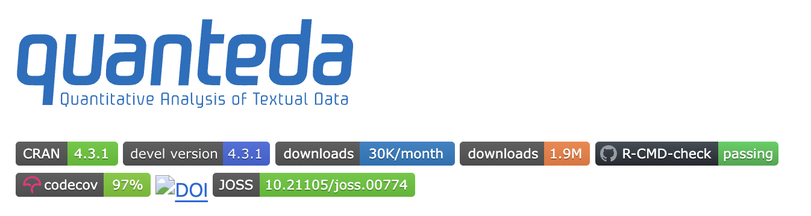

```{=html}
<style>
hr.rounded {
  border-top: 1px solid #E5E4E2;
  border-radius: 5px;
}

/* Tabset Styling - Single Row & Equal Alignment */
.nav-tabs {
  border-bottom: 2px solid #ecf0f1;
  margin-top: 1em;
  margin-bottom: 30px;
  display: flex;
  flex-wrap: nowrap;
  align-items: stretch;
}
.nav-tabs .nav-item {
  flex: 1 1 0;
  display: flex;
}
.nav-tabs .nav-link {
  font-weight: 700;
  font-size: 1.02em;
  line-height: 1.35;
  color: #95a5a6;
  border: none;
  border-bottom: 4px solid transparent;
  padding: 12px 14px;
  transition: all 0.3s ease;
  width: 100%;
  display: flex;
  align-items: center;
  justify-content: center;
  text-align: center;
}
.nav-tabs .nav-link:hover {
  color: #2c3e50;
  border: none;
  border-bottom: 4px solid #cbd5e1;
}
.nav-tabs .nav-link.active {
  color: #3498db !important;
  background: none;
  border: none;
  border-bottom: 4px solid #3498db;
}

/* Nested Sub-Tabset Styling */
.tab-content .nav-tabs {
  background-color: #f8fafc;
  border-radius: 8px;
  padding: 6px;
  border-bottom: none;
  gap: 6px;
}
.tab-content .nav-tabs .nav-link {
  font-size: 0.92em;
  padding: 10px 12px;
  border-radius: 6px;
  border-bottom: none;
}
.tab-content .nav-tabs .nav-link:hover {
  background-color: #e2e8f0;
  border-bottom: none;
}
.tab-content .nav-tabs .nav-link.active {
  background-color: #ffffff;
  color: #2563eb !important;
  border-bottom: none;
  box-shadow: 0 2px 6px rgba(0, 0, 0, 0.08);
}

/* Stunning Headers */
h2 {
  margin-top: 1.8em;
  color: #2980b9;
  font-weight: 600;
}
h3 {
  margin-top: 1.5em;
  color: #2c3e50;
  font-weight: 600;
}

/* Floating Images with Animations */
img {
  border-radius: 12px;
  box-shadow: 0 8px 25px rgba(0,0,0,0.06);
  transition: transform 0.4s cubic-bezier(0.175, 0.885, 0.32, 1.275), box-shadow 0.4s ease;
  margin: 2rem auto;
  display: block;
}
img:hover {
  transform: translateY(-6px) scale(1.02);
  box-shadow: 0 15px 35px rgba(52,152,219,0.2);
}

/* Elegant Gradient Divider */
hr.rounded {
  border: 0;
  height: 2px;
  background-image: linear-gradient(to right, rgba(0,0,0,0), rgba(52,152,219,0.5), rgba(0,0,0,0));
  margin: 4rem 0;
}

/* Pro Code Styling */
code {
  font-family: 'JetBrains Mono', monospace;
  font-size: 0.9em;
  color: #e74c3c;
  background-color: #fdf2f0;
  padding: 3px 6px;
  border-radius: 5px;
}
pre code {
  color: #333;
  background-color: transparent;
}

/* Clean Tables */
table {
  width: 100%;
  border-collapse: separate;
  border-spacing: 0;
  border-radius: 12px;
  overflow: hidden;
  box-shadow: 0 5px 15px rgba(0,0,0,0.05);
  margin: 2rem 0;
}
th {
  background-color: #3498db;
  color: white;
  text-transform: uppercase;
  letter-spacing: 1px;
  padding: 15px;
  font-weight: 600;
}
td {
  background-color: white;
  padding: 15px;
  border-bottom: 1px solid #ecf0f1;
}

/* Emphasized bolding */
b, strong {
  color: #2c3e50;
  font-weight: 700;
}

/* Responsive Concept Card Grids */
.concept-grid-3 {
  display: grid;
  grid-template-columns: repeat(3, minmax(0, 1fr));
  gap: 1.25rem;
  width: 100%;
  margin: 1.5rem 0;
  align-items: stretch;
}

.concept-grid-2 {
  display: grid;
  grid-template-columns: repeat(2, minmax(0, 1fr));
  gap: 1.25rem;
  width: 100%;
  margin: 1.5rem 0;
  align-items: stretch;
}

.concept-card-full {
  grid-column: 1 / -1;
}

.concept-card {
  box-sizing: border-box;
  border: 1px solid #e2e8f0;
  border-top: 4px solid #3b82f6;
  border-radius: 8px;
  background-color: #ffffff;
  padding: 1rem 1.25rem 1.25rem 1.25rem;
  box-shadow: 0 4px 6px -1px rgba(0, 0, 0, 0.05), 0 2px 4px -2px rgba(0, 0, 0, 0.05);
  transition: transform 0.2s ease, box-shadow 0.2s ease;
  height: 100%;
}

.concept-card > :first-child {
  margin-top: 0 !important;
  padding-top: 0 !important;
}

.concept-card:hover {
  transform: translateY(-4px);
  box-shadow: 0 10px 15px -3px rgba(0, 0, 0, 0.1), 0 4px 6px -4px rgba(0, 0, 0, 0.1);
}

.step-badge {
  display: inline-block;
  font-size: 0.75rem;
  font-weight: 700;
  letter-spacing: 0.05em;
  text-transform: uppercase;
  color: #2563eb;
  background-color: #eff6ff;
  padding: 0.2rem 0.55rem;
  border-radius: 9999px;
  margin-bottom: 0.75rem;
}

.concept-card p {
  color: #334155;
  font-size: 0.95rem;
  line-height: 1.55;
  margin: 0;
}

.concept-card ul {
  margin: 0.5rem 0 0 0;
  padding-left: 1.25rem;
  color: #334155;
  font-size: 0.95rem;
  line-height: 1.55;
}

.concept-card li {
  margin-bottom: 0.35rem;
}

.concept-card li:last-child {
  margin-bottom: 0;
}
</style>
```

## Overview

This week, you will learn how to analyze your data quickly and automatically with R.

:::: panel-tabset
## 🎯 Goals

**Data analysis:**

-   **How to analyze corpus data?:** Overall workflow, KWIC (Key Word In Context), word lists based on frequency, and combining methods.
-   **Let's do the job with R:** Using the *quanteda* package and understanding the R workflow.
-   **Explanation of the R script:** Preparing the environment, running KWIC and combined analyses, and generating frequency tables.

## 💻 Necessary codes and full script

**A brief summary of the essential elements:**

(to be given later)

**Scripts and datasets**

You can find the pre-filled Markdown document of this section <a href="https://github.com/aymeric-collart/CHU0387/blob/main/assets/files/_Internal/Markdown_Week12_Analyzing_data_QuantedaOnly.Rmd" target="_blank">here</a>. <a href="https://github.com/aymeric-collart/CHU0387/blob/main/assets/files/_Internal/Markdown_Week12_Analyzing_data_QuantedaOnly.pdf" target="_blank">Here</a> is the PDF output of the same document.

The RData output file can be downloaded <a href="https://github.com/aymeric-collart/CHU0387/blob/main/assets/files/_Internal/ArticleETToday_KWIC_You.Rdata" target="_blank">here for the KWIC analysis</a>, and <a href="https://github.com/aymeric-collart/CHU0387/blob/main/assets/files/_Internal/ArticleETToday_Top100words.Rdata" target="_blank">here for the frequency analysis</a>. The corresponding Excel files are <a href="https://github.com/aymeric-collart/CHU0387/blob/main/assets/files/_Internal/ArticleETToday_KWIC_You.xlsx" target="_blank">here (KWIC analysis)</a> and <a href="https://github.com/aymeric-collart/CHU0387/blob/main/assets/files/_Internal/ArticleETToday_Top100words.xlsx" target="_blank">here (frequency analysis)</a>.

## 📝 Homework

(to be given later)
::::

::: {.text-center .mb-4}
<a href="week12_slides.html" class="btn btn-outline-primary" target="_blank"> <i class="bi bi-window-stack"></i> View the slides of Week 12</a>
:::

<br>

<br>

# 1. How to analyze corpus data?

::::: {.panel-tabset}

## Recap & Overall workflow

Let's recap first what we learned and did in the past weeks:

:::: {.concept-grid-3}

::: {.concept-card}
<span class="step-badge">Step 1</span>

We learned what a corpus linguistics study is, the questions we can ask, and the types of corpora we can/should select to conduct the study;
:::

::: {.concept-card}
<span class="step-badge">Step 2</span>

We learned how to automatically scrape data from the Internet, with examples from different sources;
:::

::: {.concept-card}
<span class="step-badge">Step 3</span>

Last week, we learned how to "clean" the raw data, how to prepare the data for further analyses.
:::

::::

And this is the main objective for this week: **How to analyze the data that we prepared?**

Before getting into the details, we need to keep in mind the overall workflow of a corpus study. (You can zoom in)

```{r setup, include = FALSE}
library(DiagrammeR)
```

```{r, echo=FALSE, fig.align='center'}
library(DiagrammeR)

grViz("
digraph corpus_workflow {
  graph [
    rankdir = TB, 
    bgcolor = transparent,
    nodesep = 0.5,
    ranksep = 0.6
  ]

  node [
    shape = box,
    style = 'rounded,filled',
    fillcolor = '#F8FAFC',
    color = '#64748B',
    penwidth = 1.5,
    fontname = 'Helvetica, Arial, sans-serif',
    fontsize = 14,
    fontcolor = '#1E293B',
    margin = '0.35,0.2'
  ]

  edge [
    fontname = 'Helvetica, Arial, sans-serif',
    fontsize = 12,
    fontcolor = '#2563EB',
    color = '#94A3B8',
    arrowsize = 1.0,
    penwidth = 1.5
  ]

  A [label = 'Research question']
  B [label = 'Do I need corpus data', shape = diamond, fillcolor = '#EFF6FF', color = '#3B82F6']
  C [label = 'Corpus study maybe not appropriate']
  D [label = 'Proceed to the corpus study!']
  E [label = 'Select the right corpus']
  F [label = 'Select the analysis method']
  G [label = 'Proceed to the automatic analysis']
  H [label = 'Interpret the results according to the research question', fillcolor = '#F0FDF4', color = '#22C55E', penwidth = 1.8]

  A -> B
  B -> C [label = '  No  ']
  B -> D [label = '  Yes  ']
  D -> E
  E -> F
  F -> G [label = '  Word lists, KWIC, collocates, clusters, random forests, etc.  ']
  G -> H
}
", width = "100%", height = "650px")
```

::: {.callout-note icon="true"}
There are many many analyses methods. Their common point is that they involve automatic processing, which is very helpful when we are dealing with large datasets. Some analyses methods are quite straightforward and traditional (e.g., frequency tables), while some others are more on the computational side. Always remember to select the analysis method that is appropriate for your research question!
:::

For this class, two methods will be presented: Word lists and KWIC (Key Word In Context). These are classic yet very useful methods, and easy to understand and implement for any kind of research.

## KWIC (Key Word In Context)

The first type of analysis to introduce is called **Key Word In Context**, more often found under the acronym ***kwic***. The idea is that we can better understand the meaning of a word based on how it is used in a sentence. KWIC analyses are therefore very suitable **when we target a specific word or syntactic construction**.

KWIC analyses can be used for:

:::: {.concept-grid-2}

::: {.concept-card}
### Semantic analyses

Idea that the meaning of a specific word can be retrieved from its use in a sentences, based on the meaning of its *neighbors*.
:::

::: {.concept-card}
### Morphosyntactic analyses

Idea that the morphosyntactic context where a word or a construction is used is helpful in understanding its specific morphological and syntactic features, as well as the meaning it conveys.
:::

::::

Here is an example below, with the Mandarin word *keai* 'cute' (notice that these are fake data just for an illustration):

+----------------+-------------------+---------------+---------------+
| Sentence index | Before keyword    | Keyword       | After keyword |
+================+===================+===============+===============+
| Sentence 1     | hen               | keai          | de mao        |
|                |                   |               |               |
|                | (very)            | (cute)        | (DE cat)      |
+----------------+-------------------+---------------+---------------+
| Sentence 2     | feichang          | keai          | de gou        |
|                |                   |               |               |
|                | (very, extremely) | (cute)        | (DE dog)      |
+----------------+-------------------+---------------+---------------+

Based on these data, and assuming that these are the most frequent instances that we found in the corpus, we can infer that:

-   *Semantically*, the word *keai* is most often used to describe *animals* or *pets*, based on the following segment;

-   *Morphosyntactically*, the word *keai* behaves as an adjective (or stative verb, depending on the analysis), based on the preceding segment.

## Word lists based on frequency

Another extremely common way to analyse corpus data is to count the frequency of each word, in order to have an idea of the most frequently used ones. It is easy to understand: we just need to count how many times a word occurred in the dataset we have. Hopefully, we obtain a list like the one below (again, these are fake data):

+----------------+---------------+
| Word           | Frequency     |
+================+===============+
| keai (cute)    | 368           |
+----------------+---------------+
| kuaile (happy) | 354           |
+----------------+---------------+

The reality is that it is a little bit more complex that it seems to be, and we need to keep several remarks in mind:

:::: {.concept-grid-3}

::: {.concept-card}
<span class="step-badge">Remark 1</span>

Without any further data handling, it is more than likely that the most frequent words are (a) punctuation marks, and (b) grammatical markers (the so-called 'closed-class' words), since they are limited and appear obligatory in each sentence. The bad news is that you need further steps to obtain the table you wish for. The good news is that you can use this piece of information as a sanitary check. If you compute the frequency tables and it is not the case that grammatical words are most frequent, then something bad happened!
:::

::: {.concept-card}
<span class="step-badge">Remark 2</span>

Defining what a "word" is is not easy. In English, the simplest way is to say that words can be separated with a space (even if this too simple definition is misleading). In Mandarin, there are no spaces between words... People created packages with dictionaries where words are listed such that we can still cut the sentences into words, but be aware that less common or newly created ones will not be detected! If your research question is really about new words, then you may consider adding them in the computer's dictionary beforehand.
:::

::: {.concept-card}
<span class="step-badge">Remark 3</span>

Frequency tables can be further annotated, as you can add the rank of the word, the frequency in terms of percentage in addition to raw count numbers, etc.
:::

::::

## Combining KWIC and frequency-based word lists

Every kind of analysis has pros and cons, and we cannot say that one is better than another. Again, there are just better suited ways to analyze your data according to your research question. This even means that you can combine two types of analyses to obtain more insights!

For example, you can first proceed with a KWIC analysis, and you obtain the table as above. Then, in a second step, you can create the frequency table of the first word following or preceding the keyword. So it is a "KWIC + word list" analysis!

:::::

# 2. Let's do the job with R

Now we have a better ideas of how to analyze the data *conceptually*. But how to do it *technically*? This is what this section is about.

First, you can download the script <a href="https://github.com/aymeric-collart/CHU0387/blob/main/assets/files/_Internal/Markdown_Week12_Analyzing_data.Rmd" target="_blank">here</a>, as well as the dataset we will work with <a href="https://github.com/aymeric-collart/CHU0387/blob/main/assets/files/_Internal/ArticleETToday_CorpusCourse_CLEAN.Rdata" target="_blank">here</a>.

You can follow the steps below to understand how it works. But before explaining this script, more remarks are needed.

::::: {.panel-tabset}

## The *quanteda* package to conduct corpus analyses

We are very lucky that many smart and generous people around the world created R packages especially to deal with corpus data, and such packages are still being updated at the moment I am writing this section.

We are going to use the package called "quanteda". You can find more information by clicking on this [link](https://quanteda.io/).



We will also use another package developed by the same team, called "quanteda.textstats".

```{r, eval=FALSE}
install.packages("quanteda")
install.packages("quanteda.textstats")
```

::: {.callout-note icon="false"}
There exist several packages used to segment Mandarin sentences into words. Here, we will use the built-in functions of the "quanteda" package. If you browse the Internet, you will notice that some people prefer using the "jiebaR" package. The problem is that this package is not available on the CRAN anymore, and it can be quite tricky to install it on your computer. So for this week, we keep it simple!
:::

## Workflow for the analysis of corpus data in R

Here is an overview of the workflow. First, we start with the clean corpus, and then we create a new dataset where the sentences are cut into words. Based on this new dataset, we can perform a KWIC analysis, create a word list, or combine the two types of analyses. Finally, we clean a little bit (as in the example below; punctuation marks, digits, selecting only the sentence/phrase, etc.), we add back the information from the original corpus, and we are done!

```{r, echo=FALSE, fig.align='center'}
grViz("
digraph r_analysis_workflow {
  graph [
    rankdir = TB, 
    bgcolor = transparent,
    nodesep = 0.5,
    ranksep = 0.6
  ]

  node [
    shape = box,
    style = 'rounded,filled',
    fillcolor = '#F8FAFC',
    color = '#64748B',
    penwidth = 1.5,
    fontname = 'Helvetica, Arial, sans-serif',
    fontsize = 14,
    fontcolor = '#1E293B',
    margin = '0.35,0.2'
  ]

  edge [
    fontname = 'Helvetica, Arial, sans-serif',
    fontsize = 12,
    fontcolor = '#2563EB',
    color = '#94A3B8',
    arrowsize = 1.0,
    penwidth = 1.5
  ]

  A [label = 'Corpus data']
  B [label = 'Segment into words']
  C [label = 'KWIC analysis', fillcolor = '#EFF6FF', color = '#3B82F6']
  D [label = 'Word list', fillcolor = '#EFF6FF', color = '#3B82F6']
  E [label = 'Clean a little bit']
  F [label = 'Add information from the original corpus']
  G [label = 'Done!', fillcolor = '#F0FDF4', color = '#22C55E', penwidth = 1.8]

  A -> B [label = '  Identify the column with the text  ']
  B -> C
  B -> D
  C -> D [label = '  If combined analysis  ']
  D -> E
  C -> E
  E -> F
  F -> G
}
", width = "100%", height = "600px")
```

:::::

# 3. Explanation of the R script

:::::: {.panel-tabset}

## Prepare the environment

### Load the libraries

First, we need to load the necessary packages for our analysis.

```{r}
library(quanteda)
library(quanteda.textstats)
library(tidytext)
library(dplyr)
library(stringr)
library(openxlsx)
#Sys.setlocale(category = "LC_ALL", locale = "cht")
```

-   **library(quanteda):** Loads the core package we are using for text analysis, which allows us to create tokens and document-feature matrices.

-   **library(quanteda.textstats):** A companion package to *quanteda* that provides statistical functions, such as calculating word frequencies.

-   **library(tidytext):** Useful for converting text data into "tidy" formats if we need to switch between quanteda and tidyverse workflows.

-   **library(dplyr):** Essential for data manipulation (like joining tables or filtering data).

-   **library(stringr):** Provides easy-to-use functions for string manipulation and Regular Expressions.

-   **library(openxlsx):** Used at the end of the script to export our results into Excel files.

-   **Sys.setlocale(...):** This line is commented out (#), but it is there in case you run into encoding issues on Windows. It sets the system locale to Traditional Chinese.

### Load the originally scraped data R

```{r}
load(file = "ArticleETToday_CorpusCourse_CLEAN.Rdata")
```

**load(...):** We load the .Rdata file containing the cleaned ETToday corpus we prepared in previous weeks. This brings the Article_total2 object into our environment.

## Key Word In Context (KWIC)

::::: {.panel-tabset}

### Prepare the dataset

#### Prepare the dataset for the analyses

Before we can analyze the text, we need to ensure our documents have IDs and are properly tokenized.

```{r}
Article_total2$docname <- paste0("text", 1:nrow(Article_total2))

Article_tokens <- tokens(Article_total2$body)
```

-   **Article_total2\$docname \<- ...**: We create a new column called docname. We use paste0 to generate a unique ID for each article (e.g., "text1", "text2", etc.) based on the row number (nrow).

-   **Article_tokens \<- tokens(...)**: We use the quanteda function tokens() to break the text in the body column into individual words (tokens). This creates a specialized tokens object required for the next steps.

### KWIC segmentation & Annotation

#### KWIC segmentation

Now we search for a specific keyword to see how it is used in context.

```{r}
kwic_data <- kwic(Article_tokens, pattern = "有", window = 30)
```

-   **kwic(...)**: This function ("Key Word In Context") searches our tokenized text.

    -   **pattern = "有"**: We are searching for the character "有" (to have/there is).

    -   **window = 30**: We tell R to capture 30 tokens to the left (pre) and 30 tokens to the right (post) of our keyword.

#### Annotate the KWIC dataset

The kwic function gives us the context, but we lose the original metadata (like the article date or category). We need to put it back.

```{r}
kwic_data <- as.data.frame(kwic_data)

kwic_data <- right_join(kwic_data, Article_total2, by = "docname")

kwic_data <- na.omit(kwic_data)
```

-   **as.data.frame(kwic_data)**: The output of kwic is a special object; we convert it into a standard data frame so we can manipulate it easily.

-   **right_join(...)**: We merge our KWIC results with the original Article_total2 dataframe. We match them using the docname column we created earlier.

-   **na.omit(kwic_data)**: We remove any rows that have missing values (NAs) to ensure our dataset is clean for analysis.

### (Optional) Clean the context

The window of 30 words might include parts of previous or subsequent sentences. We want to "trim" the context to only the sentence containing the keyword.

```{r}
## Keep original information just in case
kwic_data$pre_original <- kwic_data$pre
kwic_data$post_original <- kwic_data$post

## Post context
symbol1 <- "\\。" 
kwic_data$post <- sub(paste0("(", symbol1, ").*"), "\\1", kwic_data$post)

symbol2 <- "\\，" 
kwic_data$post <- sub(paste0("(", symbol2, ").*"), "\\1", kwic_data$post)

symbol3 <- "\\？" 
kwic_data$post <- sub(paste0("(", symbol3, ").*"), "\\1", kwic_data$post)

symbol4 <- "\\！" 
kwic_data$post <- sub(paste0("(", symbol4, ").*"), "\\1", kwic_data$post)

## Pre context
kwic_data$pre <- sub(".*。([^*。]*)$", "。\\1", kwic_data$pre)
kwic_data$pre <- sub(".*，([^*，]*)$", "，\\1", kwic_data$pre)
kwic_data$pre <- sub(".*？([^*？]*)$", "？\\1", kwic_data$pre)
kwic_data$pre <- sub(".*！([^*！]*)$", "！\\1", kwic_data$pre)
```

-   **kwic_data\$pre_original \<- ...:** We back up the original context columns before modifying them.

-   **symbol1 \<- "\\。"**: We define the punctuation mark we want to stop at (the Chinese period). The double backslash escapes the character for Regex.

-   **sub(paste0("(", symbol1, ").\*"), "\\1", ...**): This Regular Expression looks for the first period in the post context and deletes everything after it. It effectively cuts the text off at the end of the sentence.

-   **sub(".*。(\[\^\*。\]*)\$", "。\\1", ...)**: This mirrors the operation for the pre context. It looks for the last period occurring before our keyword and deletes everything before it, so the context starts at the beginning of the current sentence.

Note: The code repeats this process for commas (，), question marks (？), and exclamation marks (！) to handle different sentence boundaries.

```{r}
## Have a look at the data (I delete some columns so that it is easier to display on the website)
kwic_data_for_website <- kwic_data
kwic_data_for_website$original_article <- NULL
kwic_data_for_website$body <- NULL
kwic_data_for_website$pre_original <- NULL
kwic_data_for_website$post_original <- NULL
knitr::kable(head(kwic_data_for_website))
```

### Combined analysis

We can now analyze what words typically follow "有".

```{r}
## Extract the first word
kwic_data$post_first_word <- word(kwic_data$post, 1)

## We need to tranform the tokenized data into a 'dfm' dataset
kwic_data_freq <- dfm( tokens(kwic_data$post_first_word, remove_punct = TRUE) )

kwic_data_freq <- textstat_frequency(kwic_data_freq)

## Clean a little bit
kwic_data_freq <- kwic_data_freq[-grep("[[:digit:]]", kwic_data_freq$feature),]

## Recreate the rank
kwic_data_freq$rank <- 1:length(kwic_data_freq$rank)

knitr::kable(head(kwic_data_freq, 100))
```

-   **word(kwic_data\$post, 1)**: Uses *stringr* to extract specifically the first word from the post (context after) column.

-   **tokens(...)**: We tokenize this list of "first words".

-   **dfm(...)**: We convert those tokens into a Document-Feature Matrix.

-   **textstat_frequency(...)**: We calculate how often each word appears.

-   **grep("\[\[:digit:\]\]", ...)**: We use *grep* to find any words that contain numbers (digits) and remove them (using the minus sign -) to clean up our results.

-   **1:length(...)**: Since we removed some rows, we reset the rank column so it goes from 1 to N sequentially.

### Save the data

Finally, we save our hard work.

```{r, eval = FALSE}
write.xlsx(kwic_data, "ArticleETToday_KWIC_You.xlsx")
save(kwic_data, file = "ArticleETToday_KWIC_You.Rdata")
```

-   **write.xlsx**: Exports the dataframe to an Excel file for manual inspection.

-   **save**: Saves the R object to an .Rdata file so we can load it quickly in future R sessions.

:::::

## Frequency tables

::::: {.panel-tabset}

### Creation of the first table

Now, let's look at the frequency of words across the entire corpus, not just around a keyword.

```{r}
Article_tokens_frequency <- dfm(
  tokens(Article_total2$body,
         remove_punct = TRUE)
  )
Article_tokens_frequency <- textstat_frequency(Article_tokens_frequency)

table_AllWordsFreq_Top100 <- head(Article_tokens_frequency, 100) 
knitr::kable(table_AllWordsFreq_Top100)
```

-   **table_AllWordsFreq_Top100 tokens(Article_total2\$body, ...)**: We tokenize the full body text of all articles, removing punctuation.

-   **dfm(...)**: We turn that huge list of tokens into a Document-Feature Matrix.

-   **textstat_frequency(...)**: We calculate the frequency of every unique word in the corpus.

-   **head(..., 100)**: We create a smaller table containing only the top 100 most frequent words.

### Clean it up a little bit

We often find "noise" in the data, like numbers, which we want to filter out.

```{r example cleaning}
## Example with numbers
table_FreqWord <- Article_tokens_frequency[-grep("[[:digit:]]", Article_tokens_frequency$feature),]

## Redo the ranking
table_FreqWord$rank <- 1:length(table_FreqWord$rank)
```

-   **grep("\[\[:digit:\]\]", ...)**: Similar to before, we search for any features (words) containing numbers and remove them from the list.

-   **1:length(...)**: We re-calculate the rank column to fill in the gaps left by the removed words.

### Final table & percentage

Frequencies are good, but percentages help us understand the relative importance of a word.

```{r}
table_FreqWord_Top100 <- head(table_FreqWord, 100)

table_FreqWord_Top100$percentage <- round(table_FreqWord_Top100$frequency/sum(table_FreqWord$frequency)*100, 5)
knitr::kable(table_FreqWord_Top100)
```

-   **table_FreqWord_Top100 head(..., 100)**: We isolate the top 100 words again after our cleaning process.
-   **table_FreqWord_Top100\$frequency/sum(table_FreqWord\$frequency)**: We divide the frequency of a specific word by the total frequency of all words in the corpus.
-   **\*100**: Convert the decimal to a percentage.
-   **round(..., 5)**: Round the result to 5 decimal places for readability.

### Save the data R

#### Save the data R

```{r, eval = FALSE}
write.xlsx(table_FreqWord_Top100, "ArticleETToday_Top100nouns.xlsx")
save(table_FreqWord_Top100, file = "ArticleETToday_Top100nouns.Rdata") 
```

-   **write.xlsx**: Saves the top 100 words table to Excel.

-   **save**: Saves the R object for later use.

:::::

::::::