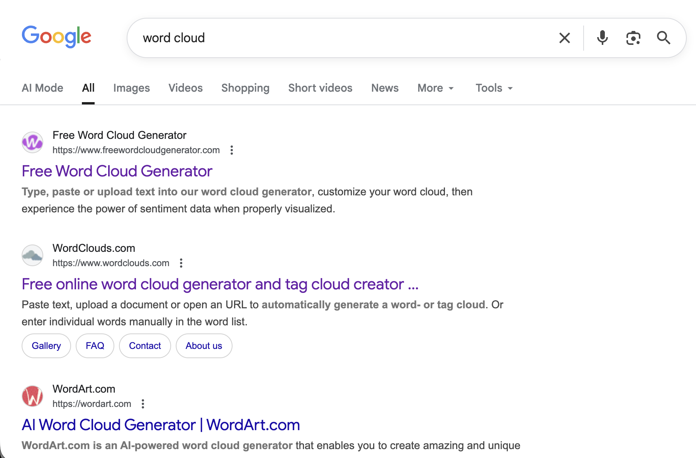
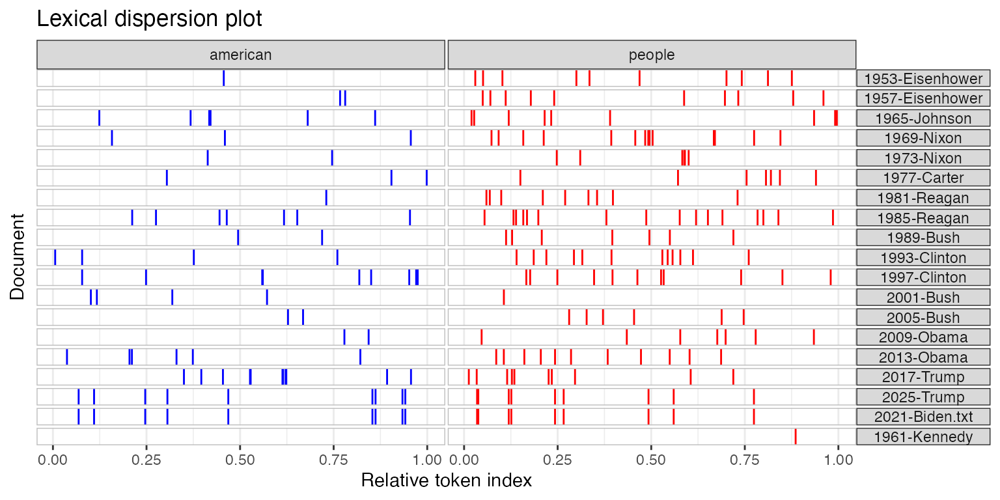
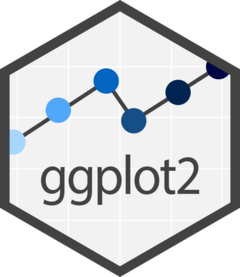
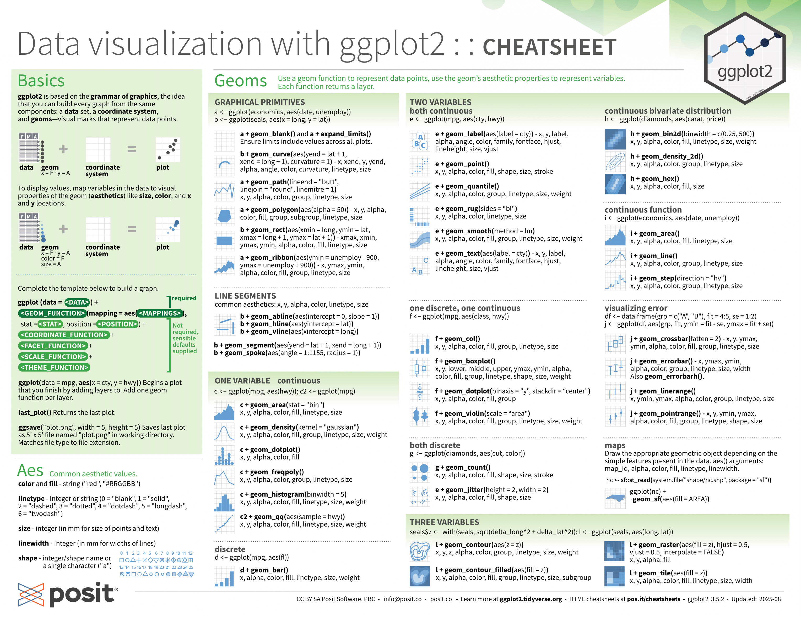
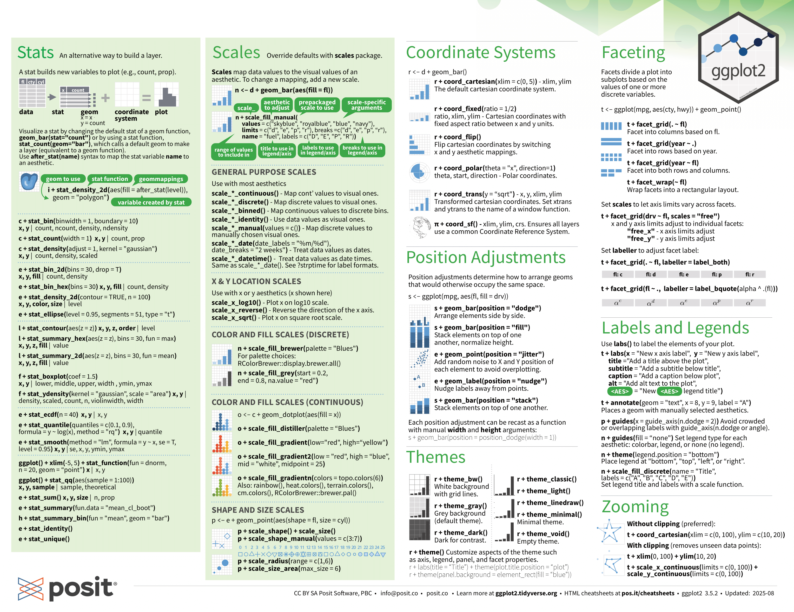

```{=html}
<style>
hr.rounded {
  border-top: 1px solid #E5E4E2;
  border-radius: 5px;
}

/* Tabset Styling - Single Row & Equal Alignment */
.nav-tabs {
  border-bottom: 2px solid #ecf0f1;
  margin-top: 1em;
  margin-bottom: 30px;
  display: flex;
  flex-wrap: nowrap;
  align-items: stretch;
}
.nav-tabs .nav-item {
  flex: 1 1 0;
  display: flex;
}
.nav-tabs .nav-link {
  font-weight: 700;
  font-size: 1.02em;
  line-height: 1.35;
  color: #95a5a6;
  border: none;
  border-bottom: 4px solid transparent;
  padding: 12px 14px;
  transition: all 0.3s ease;
  width: 100%;
  display: flex;
  align-items: center;
  justify-content: center;
  text-align: center;
}
.nav-tabs .nav-link:hover {
  color: #2c3e50;
  border: none;
  border-bottom: 4px solid #cbd5e1;
}
.nav-tabs .nav-link.active {
  color: #3498db !important;
  background: none;
  border: none;
  border-bottom: 4px solid #3498db;
}

/* Nested Sub-Tabset Styling */
.tab-content .nav-tabs {
  background-color: #f8fafc;
  border-radius: 8px;
  padding: 6px;
  border-bottom: none;
  gap: 6px;
}
.tab-content .nav-tabs .nav-link {
  font-size: 0.92em;
  padding: 10px 12px;
  border-radius: 6px;
  border-bottom: none;
}
.tab-content .nav-tabs .nav-link:hover {
  background-color: #e2e8f0;
  border-bottom: none;
}
.tab-content .nav-tabs .nav-link.active {
  background-color: #ffffff;
  color: #2563eb !important;
  border-bottom: none;
  box-shadow: 0 2px 6px rgba(0, 0, 0, 0.08);
}

/* Stunning Headers */
h2 {
  margin-top: 1.8em;
  color: #2980b9;
  font-weight: 600;
}
h3 {
  margin-top: 1.5em;
  color: #2c3e50;
  font-weight: 600;
}

/* Floating Images with Animations */
img {
  border-radius: 12px;
  box-shadow: 0 8px 25px rgba(0,0,0,0.06);
  transition: transform 0.4s cubic-bezier(0.175, 0.885, 0.32, 1.275), box-shadow 0.4s ease;
  margin: 2rem auto;
  display: block;
}
img:hover {
  transform: translateY(-6px) scale(1.02);
  box-shadow: 0 15px 35px rgba(52,152,219,0.2);
}

/* Elegant Gradient Divider */
hr.rounded {
  border: 0;
  height: 2px;
  background-image: linear-gradient(to right, rgba(0,0,0,0), rgba(52,152,219,0.5), rgba(0,0,0,0));
  margin: 4rem 0;
}

/* Pro Code Styling */
code {
  font-family: 'JetBrains Mono', monospace;
  font-size: 0.9em;
  color: #e74c3c;
  background-color: #fdf2f0;
  padding: 3px 6px;
  border-radius: 5px;
}
pre code {
  color: #333;
  background-color: transparent;
}

/* Clean Tables */
table {
  width: 100%;
  border-collapse: separate;
  border-spacing: 0;
  border-radius: 12px;
  overflow: hidden;
  box-shadow: 0 5px 15px rgba(0,0,0,0.05);
  margin: 2rem 0;
}
th {
  background-color: #3498db;
  color: white;
  text-transform: uppercase;
  letter-spacing: 1px;
  padding: 15px;
  font-weight: 600;
}
td {
  background-color: white;
  padding: 15px;
  border-bottom: 1px solid #ecf0f1;
}

/* Emphasized bolding */
b, strong {
  color: #2c3e50;
  font-weight: 700;
}

/* Responsive Concept Card Grids */
.concept-grid-3 {
  display: grid;
  grid-template-columns: repeat(3, minmax(0, 1fr));
  gap: 1.25rem;
  width: 100%;
  margin: 1.5rem 0;
  align-items: stretch;
}

.concept-grid-2 {
  display: grid;
  grid-template-columns: repeat(2, minmax(0, 1fr));
  gap: 1.25rem;
  width: 100%;
  margin: 1.5rem 0;
  align-items: stretch;
}

.concept-card-full {
  grid-column: 1 / -1;
}

.concept-card {
  box-sizing: border-box;
  border: 1px solid #e2e8f0;
  border-top: 4px solid #3b82f6;
  border-radius: 8px;
  background-color: #ffffff;
  padding: 1rem 1.25rem 1.25rem 1.25rem;
  box-shadow: 0 4px 6px -1px rgba(0, 0, 0, 0.05), 0 2px 4px -2px rgba(0, 0, 0, 0.05);
  transition: transform 0.2s ease, box-shadow 0.2s ease;
  height: 100%;
}

.concept-card > :first-child {
  margin-top: 0 !important;
  padding-top: 0 !important;
}

.concept-card:hover {
  transform: translateY(-4px);
  box-shadow: 0 10px 15px -3px rgba(0, 0, 0, 0.1), 0 4px 6px -4px rgba(0, 0, 0, 0.1);
}

.step-badge {
  display: inline-block;
  font-size: 0.75rem;
  font-weight: 700;
  letter-spacing: 0.05em;
  text-transform: uppercase;
  color: #2563eb;
  background-color: #eff6ff;
  padding: 0.2rem 0.55rem;
  border-radius: 9999px;
  margin-bottom: 0.75rem;
}

.concept-card p {
  color: #334155;
  font-size: 0.95rem;
  line-height: 1.55;
  margin: 0;
}

.concept-card ul {
  margin: 0.5rem 0 0 0;
  padding-left: 1.25rem;
  color: #334155;
  font-size: 0.95rem;
  line-height: 1.55;
}

.concept-card li {
  margin-bottom: 0.35rem;
}

.concept-card li:last-child {
  margin-bottom: 0;
}
</style>
```

## Overview

This week, you will learn how to create figures of the data that we analyzed.

:::: panel-tabset
## 🎯 Goals

**Data visualization:**

-   **Creating figures of the results, why?:** Reflections on visual presentation, word clouds, frequency dot plots, and lexical dispersion plots.
-   **Let's do the work with R:** Using the `quanteda.textplots` and `ggplot2` packages and following the visualization workflow.
-   **Explanation of the R code:** Preparing the environment, visualizing KWIC results, and plotting overall frequency tables.

## 💻 Necessary codes and full script

**A brief summary of the essential elements:**

(to be given later)

**Scripts and datasets**

| Markdown script for this week | Datasets to use in the script |
|----|----|
| <a href="https://github.com/aymeric-collart/CHU0387/blob/main/assets/files/_Internal/Markdown_Week13_DataVisualization.Rmd" target="_blank">Markdown script</a> | <a href="https://github.com/aymeric-collart/CHU0387/blob/main/assets/files/_Internal/ArticleETToday_CorpusCourse_CLEAN.Rdata" target="_blank">Whole ETtoday corpus (after cleaning)</a> |
|  | <a href="https://github.com/aymeric-collart/CHU0387/blob/main/assets/files/_Internal/ArticleETToday_KWIC_You.Rdata" target="_blank">KWIC analysis of *you* 'to have'</a> |
|  | <a href="https://github.com/aymeric-collart/CHU0387/blob/main/assets/files/_Internal/ArticleETToday_Top100words.Rdata" target="_blank">Most frequently used words</a> |

You can find the pre-filled Markdown document of this section <a href="https://github.com/aymeric-collart/CHU0387/blob/main/assets/files/_Internal/Markdown_Week13_DataVisualization.Rmd" target="_blank">here</a>. <a href="https://github.com/aymeric-collart/CHU0387/blob/main/assets/files/_Internal/Markdown_Week13_DataVisualization.pdf" target="_blank">Here</a> is the PDF output of the same document.

## 📝 Homework

(to be given later)
::::

::: {.text-center .mb-4}
<a href="week13_slides.html" class="btn btn-outline-primary" target="_blank"> <i class="bi bi-window-stack"></i> View the slides of Week 13</a>
:::

<br>

<br>

# 1. Creating figures of the results, why?

::::: {.panel-tabset}

## Visual presentation of the results

### Some reflexions on the visual presentation of the results

A great question to ask is: Why adding figures after all? We scraped the data from the Internet, we cleaned them and we analyzed them based on our research question. We even have tables to present as well, and all we need to do now is to interpret the results to deliver a great story. So, what is the place for figures?

::: callout-tip
## Think about it

When you are reading a website, or a journal article, or even when you are scrolling through social medias, do you usually read long yet very complete and informative texts first, or are you more attracted to headlines and pictures, before turning to the text?
:::

If you are aware of this natural human behavior, then you have surely already understood why adding figures to text and table results is helpful. It is because the human visual system is so important that stimulating it will be a plus when communicating the results.

Knowing how to present the results in a figure is very important as well. Having a great figure able to summarize the results such that we can grasp the intended message of the study at one glance will determine the success of the whole presentation. Conversely, a messy figure, containing too much information or just presented in an inappropriate way will blur the message, affecting the success of the presentation. Adding a figure is not enough, it requires some strategic thinking as well! You can have a look at the figures plotted with R on this webpage. Some are quite straightforward, while some are clearly just messy.

## Word clouds & Frequency dot plots

### Introduction to the figures we will learn in the tutorial: word clouds, and frequency dot plots

For this class, we will present two types of figures which are commonly used to present results from corpus exploration. The first one is called "word cloud". It is named this way, because it looks like a cloud which is made out of words. The size of these words reflect their relative frequency in the corpus analyzed. In other words, the bigger the word, the higher its frequency in the corpus. It is a way to present frequency results in a very intuitive way!

A quick search on Google shows that you can create them easily with dedicated websites. I personally used them before, and it can be quite fun to play with them. I invite you to do so, you will have a better grasp of what a word cloud is!



Frequency dot plots are another way to present the same kind of results. It looks less funny than word clouds, but it exhibits the advantage that you can add more information if you want. Put differently, where word clouds are great for their visual impact thanks to their relatively minimalist design, frequency dot plots are very useful when you want to display different types of information at the same time!

I invite you to watch this YouTube video if you want to know more about frequency dot plots (please click on the image below).

[](https://www.youtube.com/watch?v=7AjSUj-OVuE)

## Lexical dispersion plot

### Lexical dispersion plot: Compare the use of keywords across texts and/or time

So far, we looked at the frequency of words within single documents and within the same time frame. Maybe you will be interested in other types of analyses:

:::: {.concept-grid-2}

::: {.concept-card}
<span class="step-badge">Analysis 1</span>

Comparing the frequency of use of two keywords within one document;
:::

::: {.concept-card}
<span class="step-badge">Analysis 2</span>

Comparing the frequency of use of the same keyword or different keywords across time and/or between documents.
:::

::::

One way to visualize the results of such an analysis is to use a "lexical dispersion plot". There is a full tutorial on the *quanteda* website, including the R codes and the example below. Here is the link to the website: [Quanteda tutorial for figures](https://quanteda.io/articles/pkgdown/examples/plotting.html).

Let's look at an example. Let's say that you are interested in two words, "American" and "people", and how they are used in inaugural speeches of US presidents, especially (a) their frequency, and (b) the moments when they are used in the speech. You will obtain a figure like this:



Again, this is only a figure. Once we have it, you may have this question in mind: and so what? And this is the perfect question to ask. Our role, once we have the results and plotted the data, is to make them meaningful. Generally, we interpret the results according to the research question, such that we can answer the "and so what?" question.

:::::

# 2. Let's do the work with R

::::: {.panel-tabset}

## Two packages: 'quanteda' and 'ggplot2'

In this tutorial, I will only explain how to plot two types of figures: Word clouds and frequency dot plots. There are two reasons for that. The way we analyzed the data from ETtoday last week may not be ideal for a lexical dispersion plot. Of course, we could use the data from ETtoday, and reanalyze then to include, for example, different types of texts ('politics' vs. 'society' articles), or focusing on differences over time. The second reason is that the tutorial on the quanteda website is very clear, so you can really just look at it to understand how it works. In this tutorial for this week, we will mainly use two packages to plot the data.

:::: {.concept-grid-2}

::: {.concept-card}
### 'quanteda', or more precisely, 'quanteda.textplots'

Again, such as last week, we will use the 'quanteda' library, and its sub-library, 'quanteda.textplots'. If not already done, you will need to install them (if you forgot how to do so, you can go back to Week 5). And then you will just need to load them.
:::

::: {.concept-card}
### 'ggplot2'

Another package we are going to use is called 'ggplot2'.

The ggplot2 package is very powerful and useful to create figures. You can go to their website and scroll through examples of what is possible to do. Once you are very familiar with ggplot figures, you will be amazed when you are reading the news online by the fact that many figures look so familiar. This package is therefore one of the best ways to obtain very professional, good-looking figures that will help you not only for this tutorial, but also for any kind of study (Master thesis/PhD dissertation, case studies to conduct in your job, etc.).
:::

::::



You can refer to the [ggplot2 website here](https://ggplot2.tidyverse.org/). There are cheatsheets as well, to have an idea of all the functions at a glance:





## Workflow for word clouds and frequency dot plots

Like always, here is the workflow for the R tutorial this week:

```{r setup, include = FALSE}
library(DiagrammeR)
```


```{r, echo=FALSE, fig.align='center'}
library(DiagrammeR)

grViz("
digraph viz_workflow {
  graph [
    rankdir = TB, 
    bgcolor = transparent,
    nodesep = 0.5,
    ranksep = 0.6
  ]

  node [
    shape = box,
    style = 'rounded,filled',
    fillcolor = '#F8FAFC',
    color = '#64748B',
    penwidth = 1.5,
    fontname = 'Helvetica, Arial, sans-serif',
    fontsize = 14,
    fontcolor = '#1E293B',
    margin = '0.35,0.2'
  ]

  edge [
    fontname = 'Helvetica, Arial, sans-serif',
    fontsize = 12,
    fontcolor = '#2563EB',
    color = '#94A3B8',
    arrowsize = 1.0,
    penwidth = 1.5
  ]

  A [label = 'Analyzed dataset']
  B [label = 'Select appropriate figure', fillcolor = '#EFF6FF', color = '#3B82F6']
  C [label = '&#39;quanteda&#39; library', fillcolor = '#EFF6FF', color = '#3B82F6']
  D [label = '&#39;ggplot2&#39; library', fillcolor = '#EFF6FF', color = '#3B82F6']
  E [label = 'Tokenize the data, confert to &#39;dfm&#39; object']
  F [label = 'Trim the data']
  G [label = 'Create the word cloud', fillcolor = '#F0FDF4', color = '#22C55E', penwidth = 1.8]
  H [label = 'Tokenize the data, confert to &#39;dfm&#39; object']
  I [label = 'Create the dot plot', fillcolor = '#F0FDF4', color = '#22C55E', penwidth = 1.8]

  A -> B
  B -> C [label = '  Word cloud  ']
  B -> D [label = '  Frequency dot plots  ']
  C -> E
  E -> F
  F -> G
  D -> H [label = '  For &#39;combined&#39; analyses  ']
  H -> I [label = '  Compute the frequency  ']
  D -> I [label = '  If only frequency analysis  ']
}
", width = "100%", height = "600px")
```


:::::

# 3. Explanation of the R code

:::::: {.panel-tabset}

## Prepare the environment

### Load the libraries

We load the necessary tools. This week, we introduce quanteda.textplots for word clouds and ggplot2 for professional charts.

[**Crucial for Chinese Text:**]{.underline} Note the `showtext` library. By default, R plots often fail to render Chinese characters (showing empty boxes instead). `showtext_auto()` tells R to automatically detect and use a font that supports Chinese characters.

```{r, message=FALSE, warning=FALSE}
library(quanteda)
library(quanteda.textstats)
library(quanteda.textplots)
library(stringr)
library(ggplot2)
library(showtext)
library(scales)

#Sys.setlocale(category = "LC_ALL", locale = "cht")
# Use showtext_auto() to enable automatic font discovery and display Chinese characters
showtext_auto()
```

### Load the files used for the analyses

We load the data processed in previous weeks (the cleaned corpus and the KWIC analysis of "有").

```{r}
load(file = "ArticleETToday_CorpusCourse_CLEAN.Rdata")
load(file = "ArticleETToday_KWIC_You.Rdata")
load(file = "ArticleETToday_Top100words.Rdata")
```

## Visualizing KWIC

::::: {.panel-tabset}

### Post context: Word cloud

We want to visualize the words that appear after our keyword ("有").

To create a word cloud, we first convert the text tokens into a Document-Feature Matrix (DFM) using dfm(). This counts every word.

However, raw text data is noisy. We use dfm_trim() to filter the words. This function works by setting "thresholds" for which words to keep:

-   `min_termfreq` (The Floor): This removes rare words. Code: `min_termfreq = 100`. [**Logic**]{.underline}: If a word appears fewer than 100 times, it's likely a typo, a name, or irrelevant noise. We cut it out to clean the data.

-   `max_termfreq` (The Ceiling): This removes extremely common words. Code: `max_termfreq = 10000`. [**Logic**]{.underline}: In Chinese, functional particles like "的" (de) appear thousands of times. They are so big in a word cloud that they hide the meaningful content words. By setting a maximum limit, we exclude these "super-words" so we can see the actual topics.

The code below generates two clouds: one with the super-frequent words (to show the "raw" reality) and one without them (to show the meaningful content).

```{r}
## We need to tranform the tokenized data into a 'dfm' dataset
kwic_post_freq <- dfm(
  tokens(kwic_data$post,
         remove_punct = TRUE,
         remove_numbers = TRUE,
         remove_separators = TRUE))

# Version 1: Keep high-frequency words (Only trims rare words < 100)
kwic_post_freq_trim_WithDE <- dfm_trim(kwic_post_freq,
                                       min_termfreq = 100,
                                       verbose = TRUE)

# Version 2: Remove high-frequency words (Trims words > 10,000)
# This removes "stopwords" like '的' without needing a specific list.
kwic_post_freq_trim_WithoutDE <- dfm_trim(kwic_post_freq,
                                       min_termfreq = 100,
                                       max_termfreq = 10000,
                                       verbose = TRUE)

textplot_wordcloud(kwic_post_freq_trim_WithDE,
                   max_words = 100,
                   min_size = 1,
                   max_size = 5,
                   rotation = FALSE,
                   random_order = FALSE,
                   color = c('red', 'green', 'blue', "orange"))

textplot_wordcloud(kwic_post_freq_trim_WithoutDE,
                   max_words = 100,
                   min_size = 1,
                   max_size = 5,
                   rotation = FALSE,
                   random_order = FALSE,
                   color = c('red', 'green', 'blue', "orange"))
```

### Post context: Frequency plots

Word clouds are pretty, but Dot Plots (created with ggplot2) are more accurate for analysis.

-   `reorder(feature, frequency)`: This is the most important part of this code. Without it, the graph would list words alphabetically (Apple, Banana, Carrot). This function forces the graph to list words by size (Carrot, Apple, Banana), making it a readable ranking.

-   `scale_x_continuous`: This adds commas to the numbers on the axis (e.g., "1,000" instead of "1000") using the scales library.

```{r}
## We need to tranform the tokenized data into a 'dfm' dataset
kwic_data_freq_PostContext <- dfm(
  tokens(kwic_data$post,
         remove_punct = TRUE,
         remove_numbers = TRUE,
         remove_symbols = TRUE)
)

kwic_data_freq_PostContext <- textstat_frequency(kwic_data_freq_PostContext)

## Now plots
# Plot 1: Top 100 words
ggplot(head(kwic_data_freq_PostContext, 100),
       aes(x = frequency,
           y = reorder(feature, frequency))) +
  geom_point() + 
  labs(x = "Frequency", y = "Word") +
  scale_x_continuous(labels = label_comma())

# Plot 2: Top 30 words (Easier to read in a report)
ggplot(head(kwic_data_freq_PostContext, 30),
       aes(x = frequency,
           y = reorder(feature, frequency))) +
  geom_point() + 
  labs(x = "Frequency", y = "Word") +
  scale_x_continuous(labels = label_comma())
```

### First word: Word clouds

Sometimes the context (window) is large. Here, we zoom in on only the very first word after "有".

We use `word(kwic_data$post, 1)` from the *stringr* package. This function grabs the 1st word from the text string. We then repeat the DFM and Word Cloud process.

```{r}
## Extract the first word
kwic_data$post_first_word <- word(kwic_data$post, 1)

## We need to tranform the tokenized data into a 'dfm' dataset
kwic_post_FirstWord_freq <- dfm(
  tokens(kwic_data$post_first_word,
         remove_punct = TRUE,
         remove_numbers = TRUE,
         remove_separators = TRUE))

kwic_postFirstWord_freq_trim <- dfm_trim(kwic_post_FirstWord_freq,
                                         verbose = TRUE)

textplot_wordcloud(kwic_postFirstWord_freq_trim,
                   max_words = 100,
                   min_size = 1,
                   max_size = 5,
                   rotation = FALSE,
                   random_order = FALSE,
                   color = c('red', 'green', 'blue', "orange", "cyan"))
```

### First word: Frequency plots

We repeat the ggplot dot plot for the "First Word" dataset. This allows us to see the most common direct objects or verbs following "有".

```{r}
## Extract the first word
kwic_data$post_first_word <- word(kwic_data$post, 1)

## We need to tranform the tokenized data into a 'dfm' dataset
kwic_data_freq_PostFirstWord <- dfm(
  tokens(kwic_data$post_first_word,
         remove_punct = TRUE,
         remove_numbers = TRUE,
         remove_symbols = TRUE)
)

kwic_data_freq_PostFirstWord <- textstat_frequency(kwic_data_freq_PostFirstWord)

## Now plots
# Plot 1
ggplot(kwic_data_freq_PostFirstWord,
       aes(x = frequency,
           y = reorder(feature, frequency))) +
  geom_point() + 
  labs(x = "Frequency", y = "Word") +
  scale_x_continuous(labels = label_comma())

# Plot 2
ggplot(head(kwic_data_freq_PostFirstWord, 30),
       aes(x = frequency,
           y = reorder(feature, frequency))) +
  geom_point() + 
  labs(x = "Frequency", y = "Word") +
  scale_x_continuous(labels = label_comma())
```

:::::

## Frequency tables

::::: {.panel-tabset}

### Use word clouds

Finally, we apply these techniques to the entire corpus (*Article_total2\$body*), not just the search results.

Because the whole corpus is huge, the frequency numbers are much higher. Notice how we adjusted the dfm_trim settings:

-   `min_termfreq = 10000`: We only keep words that appear at least 10,000 times.

-   `max_termfreq = 300000`: We remove words that appear more than 300,000 times. In this specific dataset, that top layer is almost certainly just the character "的". By removing it, the word cloud reveals the actual news topics.

```{r}
## We need to tranform the tokenized data into a 'dfm' dataset
Article_tokens_frequency <- dfm(
  tokens(Article_total2$body,
         remove_punct = TRUE,
         remove_numbers = TRUE,
         remove_separators = TRUE))

Article_tokens_frequency_trim_WithDE <- dfm_trim(Article_tokens_frequency,
                                          min_termfreq = 10000,
                                          verbose = TRUE)

Article_tokens_frequency_trim_WithoutDE <- dfm_trim(Article_tokens_frequency,
                                          min_termfreq = 10000,
                                          max_termfreq = 300000,
                                          verbose = TRUE)

textplot_wordcloud(Article_tokens_frequency_trim_WithDE,
                   max_words = 100,
                   min_size = 1,
                   max_size = 5,
                   rotation = FALSE,
                   random_order = FALSE,
                   color = c('red', 'green', 'blue', "orange"))

textplot_wordcloud(Article_tokens_frequency_trim_WithoutDE,
                   max_words = 100,
                   min_size = 1,
                   max_size = 5,
                   rotation = FALSE,
                   random_order = FALSE,
                   color = c('red', 'green', 'blue', "orange"))
```

### Frequency plots with ggplot

We use ggplot one last time on the table_FreqWord_Top100 dataset created in Week 12.

Plot 1 shows all top 100 words. This can look crowded.

Plot 2 uses `head(..., 30)` to show only the top 30. This is a standard practice in data visualization: reducing the amount of data shown to make the chart more readable for an audience.

```{r}
## We can directly use the dataset we created last week
# Plot 1
ggplot(table_FreqWord_Top100,
       aes(x = frequency,
           y = reorder(feature, frequency))) +
  geom_point() + 
  labs(x = "Frequency", y = "Word") +
  scale_x_continuous(labels = label_comma())

# Plot 2; Observe attentively: What's the difference with the plot above?
ggplot(head(table_FreqWord_Top100, 30),
       aes(x = frequency,
           y = reorder(feature, frequency))) +
  geom_point() + 
  labs(x = "Frequency", y = "Word") +
  scale_x_continuous(labels = label_comma())
```

:::::

::::::