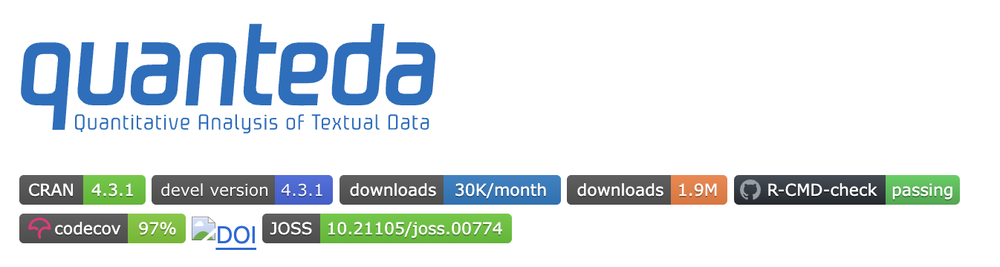

```{r setup, include = FALSE}
library(DiagrammeR)
```

## 🎯 Goals

::: {.fragment .fade-up}
- **Objective:** Learn how to analyze your cleaned corpus data quickly and automatically with R.
:::

::: {.fragment .fade-up}
- **Important note:** This is an overview of the analysis process, without reference to statistical modeling!
:::

::: {.fragment .fade-up}
- **Dataset:** Exemplified with the **ETtoday** dataset that we cleaned in Week 11.
:::

# 1. How to analyze corpus data?

## Recap of the past weeks

::::: {.columns}

:::: {.column width="33%"}
::: {.fragment .fade-up}
::: {.concept-card style="border-top-color: #3b82f6;"}
<span class="badge-pill">Step 1</span>
**Corpus design**

Learned what a corpus linguistics study is, what questions we can ask, and which corpora to select.
:::
:::
::::

:::: {.column width="33%"}
::: {.fragment .fade-up}
::: {.concept-card style="border-top-color: #8b5cf6;"}
<span class="badge-pill" style="background:#f5f3ff; color:#7c3aed;">Step 2</span>
**Web scraping**

Learned how to automatically scrape data from the Internet (*ETtoday*).
:::
:::
::::

:::: {.column width="33%"}
::: {.fragment .fade-up}
::: {.concept-card style="border-top-color: #10b981;"}
<span class="badge-pill" style="background:#ecfdf5; color:#059669;">Step 3</span>
**Data cleaning**

Learned how to clean and tidy the raw data to prepare them for further analyses.
:::
:::
::::

:::::

::: {.fragment .fade-up style="text-align: center; margin-top: 1.2em; font-size: 1.05em; color: #2563eb; font-weight: bold;"}
👉 Main objective this week: **How to analyze the data that we prepared?**
:::

## Overall workflow of a corpus study

```{r, echo=FALSE, fig.align='center'}
grViz("
digraph corpus_workflow {
  graph [
    rankdir = TB, 
    bgcolor = transparent,
    nodesep = 0.45,
    ranksep = 0.48
  ]

  node [
    shape = box,
    style = 'rounded,filled',
    fillcolor = '#F8FAFC',
    color = '#64748B',
    penwidth = 1.5,
    fontname = 'Helvetica, Arial, sans-serif',
    fontsize = 15,
    fontcolor = '#1E293B',
    margin = '0.3,0.18'
  ]

  edge [
    fontname = 'Helvetica, Arial, sans-serif',
    fontsize = 13,
    fontcolor = '#2563EB',
    color = '#94A3B8',
    arrowsize = 0.95,
    penwidth = 1.5
  ]

  A [label = 'Research question']
  B [label = 'Do I need corpus data', shape = diamond, fillcolor = '#EFF6FF', color = '#3B82F6']
  C [label = 'Corpus study maybe not appropriate']
  D [label = 'Proceed to the corpus study!']
  E [label = 'Select the right corpus']
  F [label = 'Select the analysis method']
  G [label = 'Proceed to the automatic analysis']
  H [label = 'Interpret the results according to the research question', fillcolor = '#F0FDF4', color = '#22C55E', penwidth = 1.8]

  A -> B
  B -> C [label = '  No  ']
  B -> D [label = '  Yes  ']
  D -> E
  E -> F
  F -> G [label = '  Word lists, KWIC, collocates, clusters, random forests, etc.  ']
  G -> H
}
", width = "100%", height = "480px")
```

::: {.callout-note appearance="minimal"}
💡 Always select the analysis method that fits your **research question**! Today we focus on two classic, versatile methods: **KWIC (Key Word In Context)** and **Word lists**.
:::

## Method 1: KWIC (Key Word In Context)

- **Core idea:** We can better understand the meaning and grammar of a word based on how it is used in a sentence.
- **When to use:** Ideal when targeting a **specific word or syntactic construction**.

:::: {.columns style="margin-top: 0.6em;"}

::: {.column width="48%"}
::: {.fragment .fade-up}
::: {.concept-card style="border-top: 5px solid #3b82f6; background: #f8fafc;"}
🔍 **Semantic analyses**

Retrieve the meaning of a specific word from its use in a sentence, based on the meaning of its **neighbors**.
:::
:::
:::

::: {.column width="48%"}
::: {.fragment .fade-up}
::: {.concept-card style="border-top: 5px solid #10b981; background: #f8fafc;"}
🧩 **Morphosyntactic analyses**

Use the surrounding context to identify specific **morphological and syntactic features** and the meaning they convey.
:::
:::
:::

::::

## KWIC Example: Mandarin *keai* 'cute'

Fake data for illustration:

| Sentence index | Before keyword | Keyword | After keyword |
|---|---|---|---|
| Sentence 1 | *hen* (very) | **keai** (cute) | *de mao* (DE cat) |
| Sentence 2 | *feichang* (very, extremely) | **keai** (cute) | *de gou* (DE dog) |

:::: {.columns style="margin-top: 0.8em;"}

::: {.column width="48%"}
::: {.fragment .fade-up}
::: {.concept-card style="border-top-color: #3b82f6;"}
🐱 **Semantic inference**

Based on the *following* segment (*mao* 'cat', *gou* 'dog'), *keai* is most often used to describe **animals or pets**.
:::
:::
:::

::: {.column width="48%"}
::: {.fragment .fade-up}
::: {.concept-card style="border-top-color: #10b981;"}
📐 **Morphosyntactic inference**

Based on the *preceding* degree adverbs (*hen*, *feichang*), *keai* behaves as an **adjective (or stative verb)**.
:::
:::
:::

::::

## Method 2: Word lists based on frequency

:::: {.columns}

::: {.column width="52%"}
- Count how many times each word occurs in the dataset to identify the **most frequently used words**.
- Simple in principle, but requires careful handling in practice!
:::

::: {.column width="48%"}
**Example frequency list (fake data):**

| Word | Frequency |
|---|---|
| *keai* (cute) | 368 |
| *kuaile* (happy) | 354 |
:::

::::

::::: {.columns style="margin-top: 0.6em;"}

:::: {.column width="33%"}
::: {.fragment .fade-up}
::: {.concept-card style="border-top-color: #f59e0b;"}
<span class="badge-pill" style="background:#fef3c7; color:#d97706;">Remark 1</span>
**Punctuation & Grammar**

Top items will be punctuation and closed-class grammatical markers. Good as a **sanity check**, but requires extra filtering!
:::
:::
::::

:::: {.column width="33%"}
::: {.fragment .fade-up}
::: {.concept-card style="border-top-color: #ef4444;"}
<span class="badge-pill" style="background:#fee2e2; color:#dc2626;">Remark 2</span>
**What is a "word"?**

Mandarin has no spaces between words! Segmentation relies on package dictionaries—new or rare words may not be detected unless added beforehand.
:::
:::
::::

:::: {.column width="33%"}
::: {.fragment .fade-up}
::: {.concept-card style="border-top-color: #3b82f6;"}
<span class="badge-pill">Remark 3</span>
**Further annotations**

Frequency tables can be enriched with word **rank**, **relative percentages**, etc.
:::
:::
::::

:::::

## Combining KWIC and frequency word lists

- Every analysis method has pros and cons—none is universally "better" than another.
- **You can combine both methods to gain deeper insights!**

::: {.fragment .fade-up style="margin-top: 1em;"}
::: {.concept-card style="border-top: 5px solid #8b5cf6; background: #f8fafc; padding: 1.2em;"}
🔗 **Example: "KWIC + Word List" Analysis**

1. **Step 1 (KWIC):** Search for a target keyword (e.g., `有` *you* 'to have') and extract its surrounding context.
2. **Step 2 (Word List):** Compute a frequency table of the **first word immediately following (or preceding)** the keyword!
:::
:::

# 2. Let's do the job with R

## How are we going to work in this class?

Please download the script and the cleaned dataset for this week:

:::: {.columns style="margin-top: 1.2em;"}

::: {.column width="48%"}
::: {.fragment .fade-up style="text-align: center;"}
<a href="https://github.com/aymeric-collart/CHU0387/blob/main/assets/files/_Internal/Markdown_Week12_Analyzing_data_QuantedaOnly.Rmd" 
   target="_blank" 
   style="display: inline-block; padding: 14px 24px; border: 2px solid #447099; color: #447099; text-decoration: none; border-radius: 10px; font-weight: bold;">
   📥 Download R Markdown Script
</a>
:::
:::

::: {.column width="48%"}
::: {.fragment .fade-up style="text-align: center;"}
<a href="https://github.com/aymeric-collart/CHU0387/blob/main/assets/files/_Internal/ArticleETToday_CorpusCourse_CLEAN.Rdata" 
   target="_blank" 
   style="display: inline-block; padding: 14px 24px; border: 2px solid #10b981; color: #059669; text-decoration: none; border-radius: 10px; font-weight: bold;">
   📦 Download Clean ETtoday RData
</a>
:::
:::

::::

## The `quanteda` package for corpus analysis

:::: {.columns}

::: {.column width="55%"}
- We use **[quanteda](https://quanteda.io/)** and its companion package **`quanteda.textstats`**.

```{r, echo=TRUE, eval=FALSE}
install.packages("quanteda")
install.packages("quanteda.textstats")
```

::: {.callout-note appearance="minimal"}
📌 **Note on Mandarin word segmentation:**
Some researchers use `jiebaR`, but it is no longer on CRAN and can be tricky to install. This week, we keep it simple and use `quanteda`'s built-in segmentation functions!
:::
:::

::: {.column width="45%"}
{fig-align="center"}
:::

::::

## Workflow for corpus data analysis in R

```{r, echo=FALSE, fig.align='center'}
grViz("
digraph r_analysis_workflow {
  graph [
    rankdir = TB, 
    bgcolor = transparent,
    nodesep = 0.45,
    ranksep = 0.5
  ]

  node [
    shape = box,
    style = 'rounded,filled',
    fillcolor = '#F8FAFC',
    color = '#64748B',
    penwidth = 1.5,
    fontname = 'Helvetica, Arial, sans-serif',
    fontsize = 15,
    fontcolor = '#1E293B',
    margin = '0.3,0.18'
  ]

  edge [
    fontname = 'Helvetica, Arial, sans-serif',
    fontsize = 13,
    fontcolor = '#2563EB',
    color = '#94A3B8',
    arrowsize = 0.95,
    penwidth = 1.5
  ]

  A [label = 'Corpus data']
  B [label = 'Segment into words']
  C [label = 'KWIC analysis', fillcolor = '#EFF6FF', color = '#3B82F6']
  D [label = 'Word list', fillcolor = '#EFF6FF', color = '#3B82F6']
  E [label = 'Clean a little bit']
  F [label = 'Add information from the original corpus']
  G [label = 'Done!', fillcolor = '#F0FDF4', color = '#22C55E', penwidth = 1.8]

  A -> B [label = '  Identify the column with the text  ']
  B -> C
  B -> D
  C -> D [label = '  If combined analysis  ']
  D -> E
  C -> E
  E -> F
  F -> G
}
", width = "100%", height = "520px")
```

# 3. Explanation of the R script

## Step 0: Prepare the environment

:::: {.columns}

::: {.column width="54%"}
**1. Load required packages:**

```{r, echo=TRUE, eval=FALSE}
library(quanteda)
library(quanteda.textstats)
library(tidytext)
library(dplyr)
library(stringr)
library(openxlsx)
#Sys.setlocale(category = "LC_ALL", locale = "cht")
```

- `quanteda` & `quanteda.textstats`: Tokenize text, build DFMs, and compute word frequencies.
- `tidytext` & `dplyr`: Manipulate and join tables.
- `stringr`: String manipulation and Regular Expressions.
- `openxlsx`: Export results to Excel.
:::

::: {.column width="46%"}
::: {.fragment .fade-up}
**2. Load the cleaned ETtoday data:**

```{r, echo=TRUE, eval=FALSE}
load(file = "ArticleETToday_CorpusCourse_CLEAN.Rdata")
```

- Imports `Article_total2` (cleaned in Week 11) into your R environment.
- *Note:* `Sys.setlocale(...)` is kept commented out in case Windows users encounter Traditional Chinese encoding issues.
:::
:::

::::

## Part A: Key Word In Context (KWIC) — Step 1

Before running KWIC, we assign unique document IDs and tokenize the text:

```{r, echo=TRUE, eval=FALSE}
Article_total2$docname <- paste0("text", 1:nrow(Article_total2))

Article_tokens <- tokens(Article_total2$body)
```

:::: {.columns style="margin-top: 0.8em;"}

::: {.column width="48%"}
::: {.concept-card style="border-top-color: #3b82f6;"}
**1. `Article_total2$docname`**

Creates a unique ID for each paragraph row (`"text1"`, `"text2"`, ...) using `paste0()` and `nrow()` so we can merge metadata back later.
:::
:::

::: {.column width="48%"}
::: {.concept-card style="border-top-color: #10b981;"}
**2. `tokens(Article_total2$body)`**

Breaks the text in the `body` column into individual words (tokens), creating a specialized `tokens` object.
:::
:::

::::

## KWIC — Step 2: Segmentation & Annotation

:::: {.columns}

::: {.column width="48%"}
**1. Perform KWIC segmentation:**

```{r, echo=TRUE, eval=FALSE}
kwic_data <- kwic(
  Article_tokens, 
  pattern = "有", 
  window = 30
)
```

- `pattern = "有"`: Searches for `"有"` (*to have / there is*).
- `window = 30`: Captures 30 tokens to the left (`pre`) and 30 tokens to the right (`post`).
:::

::: {.column width="52%"}
::: {.fragment .fade-up}
**2. Restore original metadata:**

```{r, echo=TRUE, eval=FALSE}
kwic_data <- as.data.frame(kwic_data)

kwic_data <- right_join(
  kwic_data, 
  Article_total2, 
  by = "docname"
)

kwic_data <- na.omit(kwic_data)
```

- Converts `kwic_data` to a data frame, merges article date/category back via `docname`, and drops `NA` rows.
:::
:::

::::

## KWIC — Step 3 (Optional): Trim Context to Clause

A 30-word window often crosses sentence boundaries. We use `sub()` to trim `post` and `pre` at punctuation marks (`。`, `，`, `？`, `！`):

```{r, echo=TRUE, eval=FALSE}
## Keep original information just in case
kwic_data$pre_original  <- kwic_data$pre
kwic_data$post_original <- kwic_data$post

## Post context: cut everything after the FIRST punctuation mark
symbol1 <- "\\。" 
kwic_data$post <- sub(paste0("(", symbol1, ").*"), "\\1", kwic_data$post)
symbol2 <- "\\，" 
kwic_data$post <- sub(paste0("(", symbol2, ").*"), "\\1", kwic_data$post)
symbol3 <- "\\？" 
kwic_data$post <- sub(paste0("(", symbol3, ").*"), "\\1", kwic_data$post)
symbol4 <- "\\！" 
kwic_data$post <- sub(paste0("(", symbol4, ").*"), "\\1", kwic_data$post)

## Pre context: delete everything before the LAST punctuation mark
kwic_data$pre <- sub(".*。([^*。]*)$", "。\\1", kwic_data$pre)
kwic_data$pre <- sub(".*，([^*，]*)$", "，\\1", kwic_data$pre)
kwic_data$pre <- sub(".*？([^*？]*)$", "？\\1", kwic_data$pre)
kwic_data$pre <- sub(".*！([^*！]*)$", "！\\1", kwic_data$pre)
```

## KWIC — Step 4: Combined Analysis (`KWIC + Word List`)

What words most frequently follow `"有"`?

```{r, echo=TRUE, eval=FALSE}
## 1. Extract the first word from the post context
kwic_data$post_first_word <- word(kwic_data$post, 1)

## 2. Transform into a Document-Feature Matrix (dfm) & calculate frequency
kwic_data_freq <- dfm(tokens(kwic_data$post_first_word, remove_punct = TRUE))
kwic_data_freq <- textstat_frequency(kwic_data_freq)

## 3. Clean out digits and reset the rank column
kwic_data_freq <- kwic_data_freq[-grep("[[:digit:]]", kwic_data_freq$feature),]
kwic_data_freq$rank <- 1:length(kwic_data_freq$rank)

head(kwic_data_freq, 10)
```

:::: {.columns style="margin-top: 0.6em;"}

::: {.column width="33%"}
::: {.concept-card style="border-top-color: #3b82f6;"}
**`word(kwic_data$post, 1)`**

Uses `stringr` to grab the **1st word** immediately after `"有"`.
:::
:::

::: {.column width="33%"}
::: {.concept-card style="border-top-color: #8b5cf6;"}
**`dfm()` + `textstat_frequency()`**

Counts how often each first word occurs across all matches.
:::
:::

::: {.column width="33%"}
::: {.concept-card style="border-top-color: #ef4444;"}
**`-grep("[[:digit:]]", ...)`**

Removes tokens containing numbers and resets `rank` from `1` to `N`.
:::
:::

::::

## Part B: Overall Frequency Tables — Step 1

Now let's compute word frequencies across the **entire corpus** (`Article_total2$body`):

```{r, echo=TRUE, eval=FALSE}
Article_tokens_frequency <- dfm(
  tokens(Article_total2$body,
         remove_punct = TRUE)
)
Article_tokens_frequency <- textstat_frequency(Article_tokens_frequency)

table_AllWordsFreq_Top100 <- head(Article_tokens_frequency, 100)
```

:::: {.columns style="margin-top: 0.8em;"}

::: {.column width="48%"}
::: {.concept-card style="border-top-color: #3b82f6;"}
**1. Tokenize & Build DFM**

`tokens(..., remove_punct = TRUE)` splits all paragraphs into words without punctuation, and `dfm()` builds the Document-Feature Matrix.
:::
:::

::: {.column width="48%"}
::: {.concept-card style="border-top-color: #10b981;"}
**2. Compute & Slice Top 100**

`textstat_frequency()` counts every unique word in the corpus, and `head(..., 100)` keeps the top 100 most frequent words.
:::
:::

::::

## Overall Frequency Tables — Step 2: Clean & Add Percentage

:::: {.columns}

::: {.column width="48%"}
**1. Filter out numbers & re-rank:**

```{r, echo=TRUE, eval=FALSE}
## Remove features containing numbers
table_FreqWord <- Article_tokens_frequency[
  -grep("[[:digit:]]", Article_tokens_frequency$feature),
]

## Redo the ranking sequentially
table_FreqWord$rank <- 1:length(table_FreqWord$rank)
```
:::

::: {.column width="52%"}
::: {.fragment .fade-up}
**2. Compute relative percentage:**

```{r, echo=TRUE, eval=FALSE}
table_FreqWord_Top100 <- head(table_FreqWord, 100)

table_FreqWord_Top100$percentage <- round(
  table_FreqWord_Top100$frequency / 
    sum(table_FreqWord$frequency) * 100, 
  5
)
```

- Divides each word's frequency by the total word count (`sum(...)`), multiplies by `100`, and rounds to 5 decimal places.
:::
:::

::::

## Step 3: Save the analyzed datasets

Export both the **KWIC dataset** and the **Top 100 Frequency table** to Excel and `.Rdata`:

:::: {.columns}

::: {.column width="48%"}
::: {.concept-card style="border-top-color: #3b82f6;"}
🔍 **1. Save KWIC results (`有`)**

```r
write.xlsx(
  kwic_data, 
  "ArticleETToday_KWIC_You.xlsx"
)
save(
  kwic_data, 
  file = "ArticleETToday_KWIC_You.Rdata"
)
```
:::
:::

::: {.column width="48%"}
::: {.concept-card style="border-top-color: #10b981;"}
📊 **2. Save Top 100 frequency table**

```r
write.xlsx(
  table_FreqWord_Top100, 
  "ArticleETToday_Top100nouns.xlsx"
)
save(
  table_FreqWord_Top100, 
  file = "ArticleETToday_Top100nouns.Rdata"
)
```
:::
:::

::::

::: {style="text-align: center; margin-top: 1.2em; font-size: 0.8em;"}
🔗 **Downloads:** 
<a href="https://github.com/aymeric-collart/CHU0387/blob/main/assets/files/_Internal/Markdown_Week12_Analyzing_data_QuantedaOnly.Rmd" target="_blank">Rmd Script</a> | 
<a href="https://github.com/aymeric-collart/CHU0387/blob/main/assets/files/_Internal/Markdown_Week12_Analyzing_data_QuantedaOnly.pdf" target="_blank">PDF Output</a> | 
<a href="https://github.com/aymeric-collart/CHU0387/blob/main/assets/files/_Internal/ArticleETToday_KWIC_You.Rdata" target="_blank">KWIC RData</a> | 
<a href="https://github.com/aymeric-collart/CHU0387/blob/main/assets/files/_Internal/ArticleETToday_Top100words.Rdata" target="_blank">Top 100 RData</a>
:::