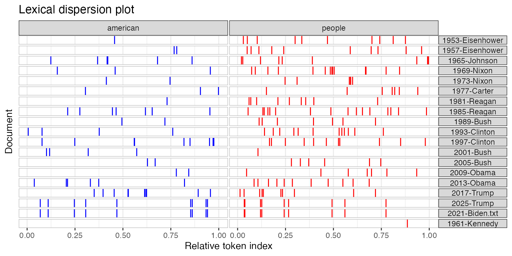
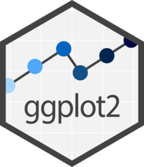
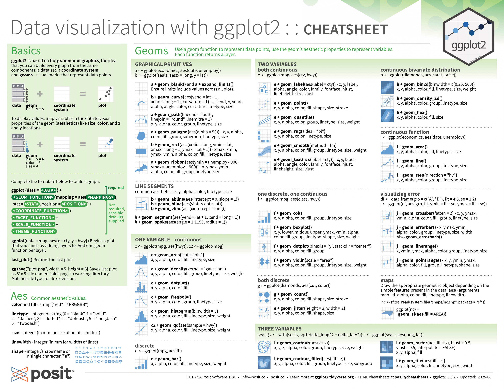
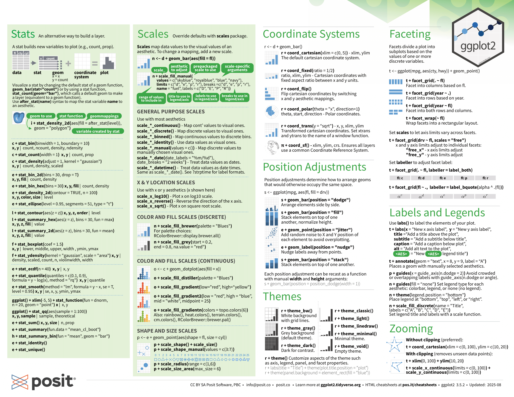

```{r setup, include = FALSE}
library(DiagrammeR)
```

## 🎯 Goals

::: {.fragment .fade-up}
- **Week 12:** Analyzed the cleaned *ETtoday* corpus using KWIC and frequency tables.
:::

::: {.fragment .fade-up}
- **Week 13:** Learn how to create clear, impactful **figures** of the data that we analyzed!
:::

# 1. Creating figures of the results, why?

## Visual presentation of the results

We scraped, cleaned, and analyzed our data—and we already have tables. **Why add figures?**

::: {.fragment .fade-up}
::: callout-tip
## Think about it

When you read a website, a journal article, or scroll through social media, do you read long, complete texts first—or are you drawn to **headlines and pictures** before turning to the text?
:::
:::

:::: {.columns style="margin-top: 0.8em;"}

::: {.column width="48%"}
::: {.fragment .fade-up}
::: {.concept-card style="border-top-color: #10b981; background: #f8fafc;"}
✅ **A great figure**

Stimulates the human visual system and summarizes the results so the audience grasps the core message **at one glance**.
:::
:::
:::

::: {.column width="48%"}
::: {.fragment .fade-up}
::: {.concept-card style="border-top-color: #ef4444; background: #fef2f2;"}
❌ **A messy figure**

Packs in too much information or uses an inappropriate format, **blurring the message** and hurting the presentation.
:::
:::
:::

::::

## Two main figures for this tutorial

:::: {.columns}

::: {.column width="48%"}
::: {.concept-card style="border-top-color: #3b82f6;"}
<span class="badge-pill">Figure Type 1</span>
☁️ **Word Clouds**

- Words are arranged in a cloud where **word size = relative frequency** in the corpus.
- **Pros:** Minimalist design, intuitive, and strong immediate visual impact!

{fig-align="center" height="220px"}
:::
:::

::: {.column width="48%"}
::: {.fragment .fade-up}
::: {.concept-card style="border-top-color: #10b981;"}
<span class="badge-pill" style="background:#ecfdf5; color:#059669;">Figure Type 2</span>
📊 **Frequency Dot Plots**

- Plots words along a ranked frequency axis.
- **Pros:** Less playful than word clouds, but **much more accurate** and allows you to display multiple types of information at once!

[{fig-align="center" height="190px"}](https://www.youtube.com/watch?v=7AjSUj-OVuE)
:::
:::
:::

::::

## Going further: Lexical dispersion plots

What if you want to compare keywords **across texts or time**?

:::: {.columns}

::: {.column width="42%"}
::: {.concept-card style="border-top-color: #8b5cf6;"}
**Two common uses:**

1. Compare the frequency of **two keywords within a single document**.
2. Compare **one or more keywords across time and/or between documents**.

🔗 [Quanteda plotting tutorial](https://quanteda.io/articles/pkgdown/examples/plotting.html)
:::
:::

::: {.column width="58%"}
{fig-align="center" height="320px"}
:::

::::

::: {.fragment .fade-up style="margin-top: 0.4em;"}
::: {.callout-important appearance="minimal"}
🤔 **"And so what?"** A figure is never the final step! Our role is to **interpret the visual patterns** according to our research question.
:::
:::

# 2. Let's do the work with R

## How are we going to work in this class?

Please download the R Markdown script and the three datasets from Weeks 11 & 12:

| Markdown script for this week | Datasets to use in the script |
|---|---|
| 📥 <a href="https://github.com/aymeric-collart/CHU0387/blob/main/assets/files/_Internal/Markdown_Week13_DataVisualization.Rmd" target="_blank">**Download Markdown script**</a> | 📦 <a href="https://github.com/aymeric-collart/CHU0387/blob/main/assets/files/_Internal/ArticleETToday_CorpusCourse_CLEAN.Rdata" target="_blank">Whole ETtoday corpus (after cleaning)</a> |
| 📄 <a href="https://github.com/aymeric-collart/CHU0387/blob/main/assets/files/_Internal/Markdown_Week13_DataVisualization.pdf" target="_blank">PDF output of the script</a> | 🔍 <a href="https://github.com/aymeric-collart/CHU0387/blob/main/assets/files/_Internal/ArticleETToday_KWIC_You.Rdata" target="_blank">KWIC analysis of *you* 'to have'</a> |
| | 📊 <a href="https://github.com/aymeric-collart/CHU0387/blob/main/assets/files/_Internal/ArticleETToday_Top100words.Rdata" target="_blank">Most frequently used words (Top 100)</a> |

## Two key packages: `quanteda.textplots` & `ggplot2`

:::: {.columns}

::: {.column width="45%"}
::: {.concept-card style="border-top-color: #3b82f6;"}
<span class="badge-pill">Package 1</span>
**`quanteda.textplots`**

- Sub-library of `quanteda` dedicated to visualizing text data.
- Used today to generate **word clouds** directly from Document-Feature Matrices (`dfm`).
:::
:::

::: {.column width="55%"}
::: {.fragment .fade-up}
::: {.concept-card style="border-top-color: #10b981;"}
<span class="badge-pill" style="background:#ecfdf5; color:#059669;">Package 2</span>
**`ggplot2`** ([website](https://ggplot2.tidyverse.org/))

- The gold standard in R for publication-ready figures (theses, journal articles, industry reports).
- Used today to build clean, ranked **frequency dot plots**.

{fig-align="center" height="120px"}
:::
:::
:::

::::

## `ggplot2` Cheatsheets

:::: {.columns}

::: {.column width="50%"}
{fig-align="center"}
:::

::: {.column width="50%"}
{fig-align="center"}
:::

::::

## Workflow for word clouds & frequency dot plots

```{r, echo=FALSE, fig.align='center'}
grViz("
digraph viz_workflow {
  graph [
    rankdir = TB, 
    bgcolor = transparent,
    nodesep = 0.45,
    ranksep = 0.5
  ]

  node [
    shape = box,
    style = 'rounded,filled',
    fillcolor = '#F8FAFC',
    color = '#64748B',
    penwidth = 1.5,
    fontname = 'Helvetica, Arial, sans-serif',
    fontsize = 15,
    fontcolor = '#1E293B',
    margin = '0.3,0.18'
  ]

  edge [
    fontname = 'Helvetica, Arial, sans-serif',
    fontsize = 13,
    fontcolor = '#2563EB',
    color = '#94A3B8',
    arrowsize = 0.95,
    penwidth = 1.5
  ]

  A [label = 'Analyzed dataset']
  B [label = 'Select appropriate figure', fillcolor = '#EFF6FF', color = '#3B82F6']
  C [label = '&#39;quanteda&#39; library', fillcolor = '#EFF6FF', color = '#3B82F6']
  D [label = '&#39;ggplot2&#39; library', fillcolor = '#EFF6FF', color = '#3B82F6']
  E [label = 'Tokenize the data, convert to &#39;dfm&#39; object']
  F [label = 'Trim the data']
  G [label = 'Create the word cloud', fillcolor = '#F0FDF4', color = '#22C55E', penwidth = 1.8]
  H [label = 'Tokenize the data, convert to &#39;dfm&#39; object']
  I [label = 'Create the dot plot', fillcolor = '#F0FDF4', color = '#22C55E', penwidth = 1.8]

  A -> B
  B -> C [label = '  Word cloud  ']
  B -> D [label = '  Frequency dot plots  ']
  C -> E
  E -> F
  F -> G
  D -> H [label = '  For &#39;combined&#39; analyses  ']
  H -> I [label = '  Compute the frequency  ']
  D -> I [label = '  If only frequency analysis  ']
}
", width = "100%", height = "520px")
```

# 3. Explanation of the R code

## Step 0: Prepare the environment

:::: {.columns}

::: {.column width="54%"}
**1. Load required libraries:**

```{r, echo=TRUE, eval=FALSE}
library(quanteda)
library(quanteda.textstats)
library(quanteda.textplots)
library(stringr)
library(ggplot2)
library(showtext)
library(scales)

# Automatically detect & render Chinese fonts in R plots!
showtext_auto()
```

::: {.callout-important appearance="minimal"}
🀄 **Crucial for Chinese text:** Without `showtext` and `showtext_auto()`, R plots often display empty boxes (`□□`) instead of Chinese characters!
:::
:::

::: {.column width="46%"}
::: {.fragment .fade-up}
**2. Load the analyzed datasets:**

```{r, echo=TRUE, eval=FALSE}
load(file = "ArticleETToday_CorpusCourse_CLEAN.Rdata")
load(file = "ArticleETToday_KWIC_You.Rdata")
load(file = "ArticleETToday_Top100words.Rdata")
```

- `Article_total2`: Full cleaned corpus.
- `kwic_data`: KWIC concordance of `"有"`.
- `table_FreqWord_Top100`: Top 100 corpus words.
:::
:::

::::

## Part A: Visualizing KWIC (`有`) — Post-context Word Cloud

We first convert `kwic_data$post` into a `dfm` and filter noise with **`dfm_trim()`**:

:::: {.columns}

::: {.column width="48%"}
::: {.concept-card style="border-top-color: #3b82f6;"}
📉 **`min_termfreq = 100` (The Floor)**

Removes **rare words** (< 100 occurrences) such as typos, rare names, or irrelevant noise.
:::
:::

::: {.column width="48%"}
::: {.concept-card style="border-top-color: #ef4444;"}
📈 **`max_termfreq = 10000` (The Ceiling)**

Removes **super-frequent function words** (> 10,000 occurrences) like `"的"` (*de*), which otherwise dwarf content words!
:::
:::

::::

```{r, echo=TRUE, eval=FALSE}
kwic_post_freq <- dfm(tokens(kwic_data$post,
                             remove_punct = TRUE, remove_numbers = TRUE, remove_separators = TRUE))

# Version 1: Keep high-frequency words (only trims rare words < 100)
kwic_post_freq_trim_WithDE <- dfm_trim(kwic_post_freq, min_termfreq = 100, verbose = TRUE)

# Version 2: Remove super-frequent words like '的' (trims > 10,000)
kwic_post_freq_trim_WithoutDE <- dfm_trim(kwic_post_freq, min_termfreq = 100, max_termfreq = 10000, verbose = TRUE)
```

## Plotting the two KWIC Word Clouds

Compare the cloud **with `"的"`** versus **without `"的"`**:

```{r, echo=TRUE, eval=FALSE}
# Cloud 1: With '的' (raw reality)
textplot_wordcloud(kwic_post_freq_trim_WithDE,
                   max_words = 100, min_size = 1, max_size = 5,
                   rotation = FALSE, random_order = FALSE,
                   color = c('red', 'green', 'blue', "orange"))

# Cloud 2: Without '的' (meaningful content words)
textplot_wordcloud(kwic_post_freq_trim_WithoutDE,
                   max_words = 100, min_size = 1, max_size = 5,
                   rotation = FALSE, random_order = FALSE,
                   color = c('red', 'green', 'blue', "orange"))
```

## KWIC Post-context: Frequency Dot Plots (`ggplot2`)

Dot plots give us an exact ranking of words in the `post` context:

:::: {.columns}

::: {.column width="44%"}
::: {.concept-card style="border-top-color: #10b981;"}
**Two key `ggplot2` tricks:**

1. **`reorder(feature, frequency)`**: Orders words on the y-axis by **frequency** instead of alphabetical order!
2. **`scale_x_continuous(labels = label_comma())`**: Formats axis numbers as `"1,000"` instead of `"1000"`.
:::
:::

::: {.column width="56%"}
```{r, echo=TRUE, eval=FALSE}
kwic_data_freq_PostContext <- dfm(
  tokens(kwic_data$post,
         remove_punct = TRUE,
         remove_numbers = TRUE,
         remove_symbols = TRUE)
)
kwic_data_freq_PostContext <- textstat_frequency(kwic_data_freq_PostContext)

# Top 30 words (much easier to read than Top 100!)
ggplot(head(kwic_data_freq_PostContext, 30),
       aes(x = frequency,
           y = reorder(feature, frequency))) +
  geom_point() + 
  labs(x = "Frequency", y = "Word") +
  scale_x_continuous(labels = label_comma())
```
:::

::::

## Zooming in: First Word After `"有"` (Word Cloud)

A 30-word window is wide. Let's zoom in on **only the 1st word** immediately following `"有"` using `word(kwic_data$post, 1)`:

```{r, echo=TRUE, eval=FALSE}
## 1. Extract the 1st word after "有"
kwic_data$post_first_word <- word(kwic_data$post, 1)

## 2. Convert to DFM and trim
kwic_post_FirstWord_freq <- dfm(
  tokens(kwic_data$post_first_word,
         remove_punct = TRUE,
         remove_numbers = TRUE,
         remove_separators = TRUE))

kwic_postFirstWord_freq_trim <- dfm_trim(kwic_post_FirstWord_freq, verbose = TRUE)

## 3. Plot the word cloud
textplot_wordcloud(kwic_postFirstWord_freq_trim,
                   max_words = 100, min_size = 1, max_size = 5,
                   rotation = FALSE, random_order = FALSE,
                   color = c('red', 'green', 'blue', "orange", "cyan"))
```

## Zooming in: First Word After `"有"` (Dot Plots)

Plotting the top 30 first words with `ggplot2` reveals the most common direct objects or verbs following `"有"`:

```{r, echo=TRUE, eval=FALSE}
## Compute frequencies of the 1st word after "有"
kwic_data_freq_PostFirstWord <- dfm(
  tokens(kwic_data$post_first_word,
         remove_punct = TRUE,
         remove_numbers = TRUE,
         remove_symbols = TRUE)
)
kwic_data_freq_PostFirstWord <- textstat_frequency(kwic_data_freq_PostFirstWord)

## Plot Top 30 first words
ggplot(head(kwic_data_freq_PostFirstWord, 30),
       aes(x = frequency,
           y = reorder(feature, frequency))) +
  geom_point() + 
  labs(x = "Frequency", y = "Word") +
  scale_x_continuous(labels = label_comma())
```

## Part B: Whole Corpus Frequency — Word Clouds

Now we visualize `Article_total2$body` across the **entire corpus**. Because the corpus is huge, we raise the `dfm_trim()` thresholds:

:::: {.columns}

::: {.column width="45%"}
::: {.concept-card style="border-top-color: #f59e0b;"}
**Adjusted whole-corpus thresholds:**

- **`min_termfreq = 10000`**: Keep only words occurring at least 10,000 times.
- **`max_termfreq = 300000`**: Remove `"的"` (> 300,000 occurrences) so actual news topics stand out!
:::
:::

::: {.column width="55%"}
```{r, echo=TRUE, eval=FALSE}
Article_tokens_frequency <- dfm(
  tokens(Article_total2$body,
         remove_punct = TRUE, remove_numbers = TRUE, remove_separators = TRUE))

# With '的'
Article_tokens_frequency_trim_WithDE <- dfm_trim(
  Article_tokens_frequency, min_termfreq = 10000, verbose = TRUE)

# Without '的' (max_termfreq = 300000)
Article_tokens_frequency_trim_WithoutDE <- dfm_trim(
  Article_tokens_frequency, min_termfreq = 10000, max_termfreq = 300000, verbose = TRUE)

textplot_wordcloud(Article_tokens_frequency_trim_WithoutDE,
                   max_words = 100, min_size = 1, max_size = 5,
                   rotation = FALSE, random_order = FALSE,
                   color = c('red', 'green', 'blue', "orange"))
```
:::

::::

## Whole Corpus Frequency — Dot Plots (`ggplot2`)

Using `table_FreqWord_Top100` from Week 12, compare **Top 100** vs. **Top 30**:

```{r, echo=TRUE, eval=FALSE}
# Plot 1: All Top 100 words (crowded y-axis!)
ggplot(table_FreqWord_Top100,
       aes(x = frequency,
           y = reorder(feature, frequency))) +
  geom_point() + 
  labs(x = "Frequency", y = "Word") +
  scale_x_continuous(labels = label_comma())

# Plot 2: Top 30 words using head(..., 30) -> much cleaner for an audience!
ggplot(head(table_FreqWord_Top100, 30),
       aes(x = frequency,
           y = reorder(feature, frequency))) +
  geom_point() + 
  labs(x = "Frequency", y = "Word") +
  scale_x_continuous(labels = label_comma())
```

::: {.fragment .fade-up style="margin-top: 0.8em;"}
::: {.callout-note appearance="minimal"}
💡 **Takeaway:** Showing *less* data (`head(..., 30)` instead of `100`) often makes your chart **much more readable and persuasive** for your audience!
:::
:::