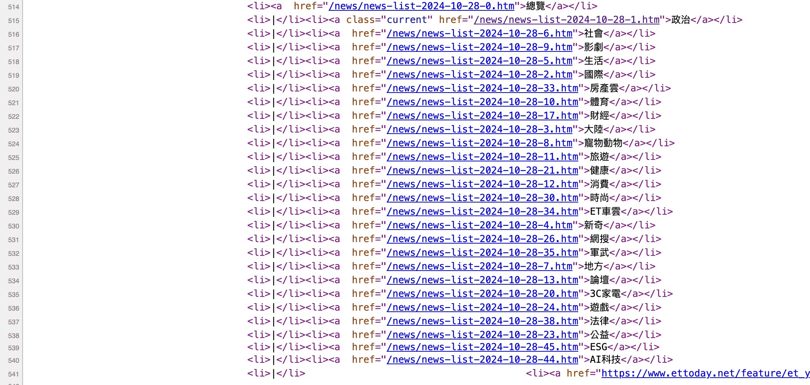
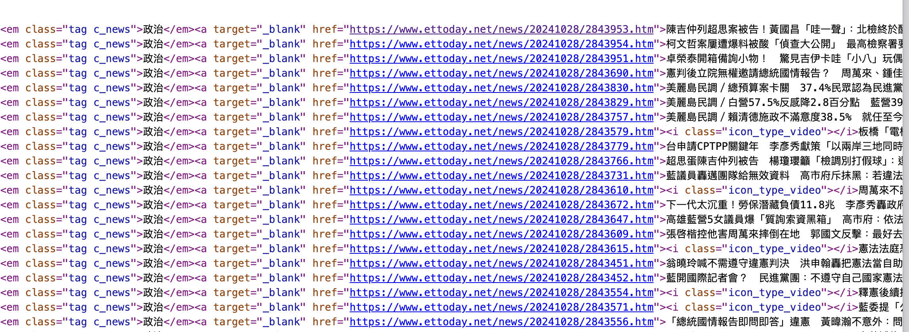
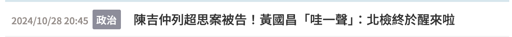

```{r setup, include = FALSE}
library(DiagrammeR)
```

## 🎯 Goals

::: {.fragment .fade-up}
- **Week 7: Understanding a web page:** What is the structure of a web page? How to find the data we want?
:::

# 1. Building your own corpus: Conceptual and technical considerations

## Clarifying concepts before coding


::::: {.columns}

:::: {.column width="33%"}
::: {.fragment .fade-up}
::: {.concept-card}
**Step 1**

Being aware of the *steps* you are going through if you had to manually copy and paste the data you want into an Excel file, and document each step with as many details as possible.
:::
:::
::::

:::: {.column width="33%"}
::: {.fragment .fade-up}
::: {.concept-card}
**Step 2**

Understanding the *structure* of a website, how to *access* the structure of the website, and *where* the information you want are.
:::
:::
::::

:::: {.column width="33%"}
::: {.fragment .fade-up}
::: {.concept-card}
**Step 3**

Finally, *mapping* the R functions to the information you want.
:::
:::
::::

:::::

## Our case study: ETtoday

Taiwanese newspaper called "ETtoday" (<https://www.ettoday.net/>). 

We will be working with the following link:

<div style="text-align: center; margin-top: 1.2em;">
  <a href="https://www.ettoday.net/news/news-list.htm" target="_blank" style="background-color: #2563eb; color: #ffffff; padding: 12px 24px; border-radius: 6px; font-weight: bold; text-decoration: none; box-shadow: 0 4px 6px rgba(0,0,0,0.1); display: inline-block; font-size: 0.9em;">
    🔗 Open ETtoday article list (2011–Present)
  </a>
</div>

{fig-align="center" height="180px"}


# 2. Document your own manual steps

## Activity #1: Write down the recipe

:::: {.columns}

::: {.column width="48%"}
::: {.concept-card style="border-top: 5px solid #3b82f6; padding: 1.2em; background: #f8fafc; border-radius: 8px; height: 100%;"}

🌐 **Step 1: Browse**

Go to the ETtoday website and navigate to find a single article of interest.
:::
:::

::: {.column width="48%"}
::: {.concept-card style="border-top: 5px solid #10b981; padding: 1.2em; background: #f8fafc; border-radius: 8px; height: 100%;"}

🤖 **Step 2: Code-like precision**

Describe every single action as if you were explaining it to a robot. Leave zero ambiguity!
:::
:::

::::

## Documentation of the manual steps

:::: {.columns}

::: {.column width="35%"}
1. Click on the link. 

2. Select the date of the news you are interested in.

3. Select the type of news (politics, society, etc.). 

4. Click on one of the titles below the search bar.

:::

::: {.column width="65%"}
```{r, echo=FALSE, fig.align='center'}
grViz("
digraph manual_steps {
  graph [
    rankdir = TB, 
    bgcolor = transparent,
    nodesep = 0.6,
    ranksep = 0.65
  ]

  node [
    shape = box,
    style = 'rounded,filled',
    fillcolor = '#F8FAFC',
    color = '#64748B',
    penwidth = 1.5,
    fontname = 'Helvetica, Arial, sans-serif',
    fontsize = 16,
    fontcolor = '#1E293B',
    margin = '0.4,0.25'
  ]

  edge [
    fontname = 'Helvetica, Arial, sans-serif',
    fontsize = 14,
    fontcolor = '#2563EB',
    color = '#94A3B8',
    arrowsize = 1.1,
    penwidth = 1.6
  ]

  A [label = 'ETtoday website\\n(list of articles)']
  B [
    label = 'Filtered articles', 
    fillcolor = '#EFF6FF', 
    color = '#3B82F6',
    penwidth = 1.8
  ]
  C [label = 'Click on title of target article']
  D [label = 'Target article webpage']
  E [
    label = 'Copy title, date, and content\\ninto Excel / Word',
    fillcolor = '#F0FDF4',
    color = '#22C55E',
    penwidth = 1.8
  ]

  A -> B [label = '  Select date & type  ']
  B -> C
  C -> D
  D -> E
}
", width = "100%", height = "520px")
```
:::

::::

## Activity #2: Web address

:::: {.columns}

::: {.column width="40%"}
::: {.fragment .fade-up}
::: {.concept-card style="border-top: 5px solid #3b82f6; padding: 1.2em; background: #f8fafc; border-radius: 8px; height: 100%;"}

**Browse and observe**

- What is the web address when you select a particular date, let's say October 28th, 2024?

- And when you select a particular type of article, "politics" for example?

- And finally, when you choose an individual article?
:::
:::
:::

::: {.column width="58%"}
::: {.fragment .fade-up}
::: {.concept-card style="border-top: 5px solid #10b981; padding: 1.2em; background: #f8fafc; border-radius: 8px; height: 100%;"}

**Answer**

- First step: <https://www.ettoday.net/news/news-list.htm>

- Second step (filtered articles): <https://www.ettoday.net/news/news-list-2024-10-28-1.htm>

- Third step (individual article): <https://www.ettoday.net/news/20241028/2843953.htm>

:::
:::
:::

::::


## Pay attention to the web address (2/2)

::: callout-tip
## Think about it

- Systematic change of the address of the website.

::: {.fragment .fade-up}

- Now, try to change the address to access the list of articles published on September 27th, 2024.

:::

::: {.fragment .fade-up}

- Second, try to change the last number. You will see that it changes the type of articles.

:::
::: {.fragment .fade-up}

**So this means that you can filter the list of articles as you wish just by changing the web address!**

:::
::: {.fragment .fade-up}
- Third, if we look at the web address of the individual article, we can retrieve the date of publication of the article very easily... but it is not quite possible to guess the numbers after that.
:::
:::

---

No need to despair! 

The fact that this article is found in the list means that ***the web address of the individual article*** must be somewhere on the website... but where? 

This is the moment when it is important to **understand the structure of the website**.

# 3. Understanding the structure of the website

## How to access the structure of the website?

- Access this page: 

<https://www.ettoday.net/news/news-list-2024-10-28-1.htm>.

- Look for a blank space,  right-click, and you select "View Page Source".

- Then, it will open a new page which can be very scary... but this is actually the same, just the structure of the previous page!

{fig-align="center"}


## Activity #3: Find the addresses on this page

:::: {.columns}

::: {.column width="40%"}
::: {.fragment .fade-up}
::: {.concept-card style="border-top: 5px solid #3b82f6; padding: 1.2em; background: #f8fafc; border-radius: 8px; height: 100%;"}

**Browse and observe - Part 1**

- Try to find the place where you have the list of the web addresses by category

:::
:::
:::

::: {.column width="58%"}
::: {.fragment .fade-up}
::: {.concept-card style="border-top: 5px solid #10b981; padding: 1.2em; background: #f8fafc; border-radius: 8px; height: 100%;"}

**Browse and observe - Part 2**

- Try to find where the individual articles are listed

:::
:::
:::

::::


## What are all these lines about? (1/2)

This version of the website is really where you can find all the information that you need. For example, please have a look at lines 514 to 541 (see the image below).

{fig-align="center"}

This must be more familiar to you: these are the web addresses that you obtain when you filter different types of articles!


## What are all these lines about? (2/2)

Now, please have a look at line 549... you will see that you have the web addresses of each individual article listed on the webpage!

{fig-align="center"}

::: callout-tip
## How did I know what lines to search for?

There's nothing magical, and I am surely not a psychic who can guess the line numbers. So how to find them? I just use the "search" function (for Windows: "ctrl + f", for Mac: "command + f"). And then I look for some keywords, such as the names of the types of articles, or the web address of the individual articles.
:::

## Terminology of the "structural lines"

Let's call these lines the "structural lines". These are just lines of code used to create the webpage. There are different programming languages, but for our purpose, we will only need to look at the lines written in **html language**.

Let's just have a look at line 549 and decompose it.

```html
<div class="part_list_2">
  <h3>
    <span class="date">2024/10/28 20:45</span>
    <em class="tag c_news">政治</em>
    <a target="_blank" href="[https://www.ettoday.net/news/20241028/2843953.htm](https://www.ettoday.net/news/20241028/2843953.htm)">陳吉仲列超思案被告！黃國昌「哇一聲」：北檢終於醒來啦</a>
  </h3>
</div>
```

This line corresponds to this part of the website:

{fig-align="center"}

## Decomposing line 549

Now we can decompose it:

- The part with "`<div></div>`" means that there is a block on the webpage. This block corresponds to the one where all the individual articles are listed. There are many blocks on a webpage, so we can give them different names to avoid confusing them. Here, the block is called "part_list_2".

- The part with "`<h3></h3>`" corresponds to one line in the block. What is between "`<h3>`" and "`</h3>`" is everything we want to put in that line. Here there are three elements:

  - The first element is a "`<span></span>`" element, and its name is "date". What is between "`<span>`" and "`</span>`" is the text to display, here: "2024/10/28 20:45".

  - The second element is an "`<em></em>`" element (why "em" and not "span"? "em" stands for "emphasis", so they look different on the website). Its name is "tag c_news".

  - The third element is an "`<a></a>`" element. This is used to write a text with a link, and the link is specified with "href". The term `target="_blank"` means that it opens in a new page when you click on it.


## Activity #4: Identify where the information you want can be found

:::: {.columns}

::: {.column width="48%"}
::: {.concept-card style="border-top: 5px solid #3b82f6; padding: 1.2em; background: #f8fafc; border-radius: 8px; height: 100%;"}

🌐 **Step 1: Browse**

Look for the dates of the article, the content, the name of the author, the category, etc.

:::
:::

::: {.column width="48%"}
::: {.concept-card style="border-top: 5px solid #10b981; padding: 1.2em; background: #f8fafc; border-radius: 8px; height: 100%;"}

🤖 **Step 2: Code-like precision**

Describe where it is found using elements like "`<div></div>`" or "`<h3></h3>`", etc.
:::
:::

::::

## Summary: What to remember

::: callout-important
This seems to be a lot and quite complicated.

So just remember this:

- There are **big blocks** with different names (*div*, *h3*, *span*, etc.). Let's call them ***nodes***.

- Inside nodes, you can specify the **parameters** and **names** specific to the **nodes**.

That's all!
:::